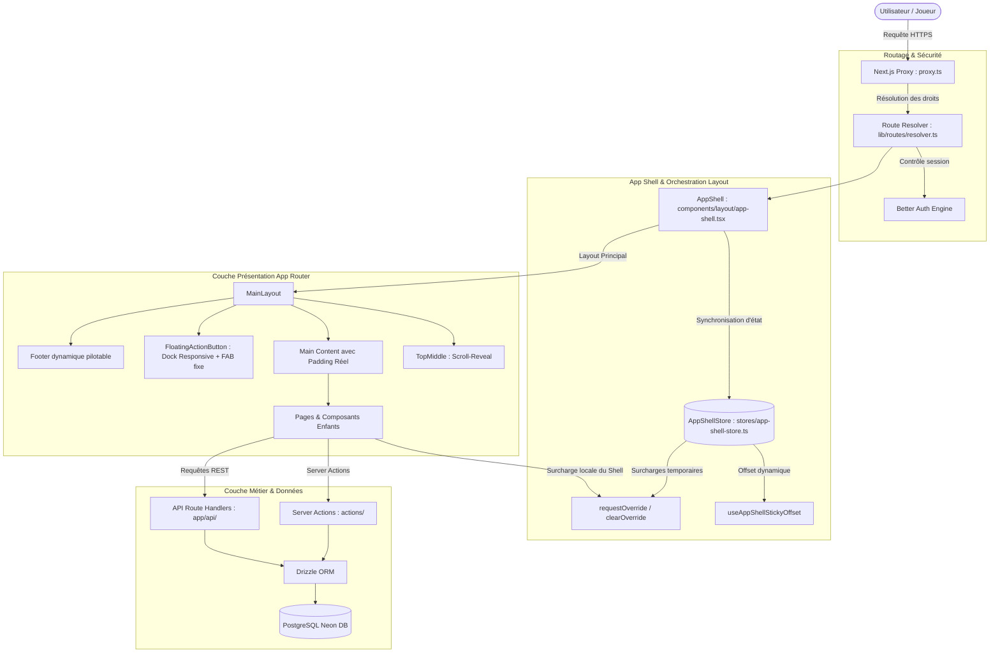
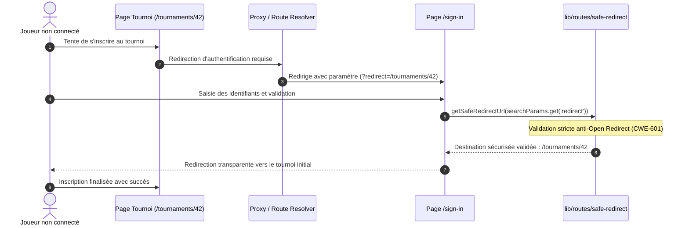

# 🏗️ Architecture Globale — Games-Trafics

> **Games-Trafics**  
> *"Joue, échange, domine — L'infini du gaming commence ici."*

Ce document constitue la référence centrale de l'architecture technique, fonctionnelle, ergonomique et sécuritaire de la plateforme Games-Trafics.

---

## 1. Stack Technique Réelle

- **Framework Web & API** : Next.js 16.4.3 (App Router, Turbopack, Partial Prefetching).
- **Langage** : TypeScript 5.x (Typage strict intégral, sans régression).
- **Runtimes & Gestionnaire de Paquets** : Node.js LTS, Bun.
- **Base de Données & ORM** : PostgreSQL managé (Neon serverless) avec Drizzle ORM.
- **Authentification & Sessions** : Better-Auth (`auth.api.getSession`, cookies HTTP-Only sécurisés, support Passkey).
- **Chiffrement & Sécurité** : AES-256-GCM (`lib/encryption.ts`) pour les données sensibles (codes PIN, identifiants).
- **Gestion d'État Layout & Communication UI** : Zustand (`stores/app-shell-store.ts`) pour la coordination temps réel des éléments du App Shell.
- **Interface, Design & Animations** : Tailwind CSS, Framer Motion, Radix UI, Lucide Icons.
- **Tests Automatisés** : Vitest (270 tests unitaires et de sécurité validés, 29 suites de tests).

---

## 2. Structure des Répertoires et Responsabilités

```
games-trafics/
├── actions/                  # Server Actions Next.js (Mutations, transactions, tournois, éditions)
│   ├── README.md             # Documentation spécialisée des Server Actions
│   ├── tournaments.ts        # Gestion des tournois
│   ├── editions.ts           # Cycle de vie, gestion et relations des éditions (getRelatedEditions)
│   ├── edition-registrations.ts # Inscriptions unifiées aux éditions
│   ├── phases.ts             # Phases, poules, matchs et qualification
│   └── transactions.ts       # Opérations de portefeuille
├── app/                      # Next.js App Router (Pages, layouts, route handlers)
│   ├── README.md             # Documentation spécialisée des pages et layouts
│   ├── (auth)/               # Routes d'authentification (connexion, inscription, réinitialisation)
│   ├── (protected)/          # Espace membre sécurisé (Dashboard, Wallet, Profil)
│   ├── admin/                # Console d'administration
│   ├── api/                  # Route Handlers REST
│   └── tournaments/          # Consultation, dashboard et détails des éditions de tournois
│       └── [tournamentId]/editions/[editionId]/
│           ├── page.tsx      # Page principale des détails d'édition avec carousels
│           └── reveal/       # Page dédiée à l'expérience 3D de révélation de structure
├── components/               # Composants UI React
│   ├── cards/                # Cartes réutilisables (EditionCard, TournamentCard, MatchCard)
│   ├── dashboard/            # DashboardHeader (scroll-reveal), EnhancedDashboard, Sidebar
│   ├── layout/               # AppShell, MainLayout, TopMiddle, FloatingActionButton (Dock unifié)
│   ├── pages/                # Vues de pages (edition-detail, marketplace, transactions)
│   ├── tournaments/          # Moteur de playoffs, brackets visuels, calendrier
│   └── shared/               # InteractionButton, ConfirmationDialog, QrCode
├── config/                   # Configurations globales (routes-config.ts)
├── database/                 # Schéma PostgreSQL Drizzle (schema.ts) et migrations
├── hooks/                    # Hooks React personnalisés (use-auth, use-profile, use-editions, etc.)
├── lib/                      # Services utilitaires (auth, encryption, safe-redirect, playoffs-engine)
├── proxy.ts                  # Point d'entrée proxy Next.js 16 (contrôle d'accès et routage)
├── stores/                   # Stores Zustand (app-shell-store.ts)
└── tests/                    # Suites de tests Vitest (sécurité, finance, tournois, permissions)
```

---

## 3. Schéma Global de l'Architecture



---

## 4. Système de Pilotage Centralisé du App Shell (`stores/app-shell-store.ts`)

Le App Shell assure une communication bidirectionnelle entre le layout parent et les composants enfants :

### 4.1. Invariants et Architecture d'État
- **Configuration initiale par Route** : Chaque route définit ses paramètres par défaut (`layout`, `topMiddle`, `breadcrumbs`, `floatingDock`, `footer`) via `lib/routes/resolver.ts`.
- **Système de Surcharges Temporaires (`overrides`)** : Les composants enfants peuvent demander dynamiquement l'affichage ou le masquage d'un composant (`requestOverride(key, value, componentId)`).
- **Nettoyage automatique** :
  - Au démontage du composant enfant : `clearOverride(componentId)`.
  - Au changement de route : `syncRoute()` réinitialise l'ensemble des surcharges, éliminant tout effet de bord.
- **Calcul Dynamique des Offsets (`useAppShellStickyOffset`)** :
  - Somme temps réel de `topMiddle.height` (si visible) + `breadcrumbs.height` (si visible).
  - Évite les valeurs statiques arbitraires (`pt-20`, `top: 64px`) et empêche tout chevauchement ou décalage visuel.

### 4.2. Harmonisation du Scroll-Reveal (TopMiddle, DashboardHeader, Edition Tabs)
Les en-têtes et barres de navigation adoptent un comportement unifié via Framer Motion (`useScroll`, `useMotionValueEvent`) :
1. **Défilement descendant (`scroll down > 100px`)** : Les barres glissent hors de l'écran (`y: -100%`) pour maximiser l'espace de lecture.
2. **Défilement montant (`scroll up`)** : Les barres réapparaissent instantanément en position fixe (`y: 0`) sous l'élément parent prioritaire.
3. **Retour en haut de page** : Les éléments reprennent leur position naturelle dans le flux sans saut de mise en page.

---

## 5. Dock Responsive et Floating Action Button Unifié (`FloatingActionButton.tsx`)

Le Floating Action Button fait désormais partie intégrante du Dock d'actions au lieu d'être un élément détaché :

```
┌──────────────────────────────────────────────────────────────┐
│  [Zone Scrollable Horizontalement]                 [FAB +]   │
│  ┌──────┐ ┌──────┐ ┌──────┐ ┌──────┐ ┌──────┐     ┌────────┐ │
│  │ Item │ │ Item │ │ Item │ │ Item │ │ Item │ ... │  ( + ) │ │
│  └──────┘ └──────┘ └──────┘ └──────┘ └──────┘     └────────┘ │
└──────────────────────────────────────────────────────────────┘
```

- **Seuils Responsives** :
  - **Mobile & tablettes (`< lg`)** : 4 éléments visibles au maximum.
  - **Desktop (`≥ lg`)** : 6 éléments visibles au maximum.
- **Défilement Horizontal Fluide** : Si le nombre d'éléments dépasse le seuil, la zone défile horizontalement sans barre de défilement visible (`scrollbar-none`).
- **FAB Positionné en Absolu à Droite** :
  - Le bouton `+` reste ancré à droite du conteneur du dock.
  - Ne défile pas avec les autres éléments.
  - La zone de défilement réserve un espacement à droite (`pr-16`) pour empêcher tout chevauchement des derniers éléments sous le FAB.
  - Menu contextuel d'actions rapides ouvrant vers le haut au-dessus du dock.

---

## 6. Architecture de la Page Edition Detail (`app/.../editions/[editionId]`)

1. **Onglets de Compétition Scroll-Reveal** :
   - Positionnés sous le Hero e-sport.
   - Ne collent pas immédiatement en descente pour laisser défiler le contenu naturellement.
   - Réapparaissent en position fixe dès que l'utilisateur remonte, immédiatement sous le TopMiddle (`top: stickyTop`).
   - Compact Header animé affichant le mini-logo, titre et statut quand le hero est hors champ.
2. **Carousels d'Éditions Associées (`edition-related-carousel.tsx`)** :
   - Section 1 : Autres éditions de ce même tournoi.
   - Section 2 : Éditions similaires par jeu / catégorie.
   - Navigation tactile sur mobile, boutons précédent/suivant sur desktop.
3. **Moteur Dynamique de Playoffs (`lib/tournaments/playoffs-engine.ts`)** :
   - Supporte les brackets simples et doubles éliminations, demi-finales, finales et matches de classement.
4. **Révélation 3D E-sport (`/reveal`)** :
   - Page dédiée avec animations séquentielles (édition, phases, groupes, brackets, participants).
   - Déclencheur unique par utilisateur via `localStorage` (`gt_edition_revealed_${editionId}`).

---

## 7. Flux d'Authentification, Autorisation et Redirection



---

## 8. Stratégie de Performance, Cache et Sécurité

1. **Déduplication au rendu** : Utilisation de requêtes mutualisées et de Server Actions pour éviter les allers-retours superflus.
2. **Navigation fluide sans blocage** : L'AppShell évalue les routes publiques sans bloquer leur affichage sur des requêtes privées.
3. **Contrôles d'accès serveurs stricts** : Toutes les mutations financières et d'inscriptions vérifient cryptographiquement les identités et permissions sans se fier aux paramètres client.
4. **Chiffrement AES-256-GCM** : Codes PIN et identifiants sensibles sécurisés avec clé 256 bits et vecteurs d'initialisation aléatoires.

---

## 9. Invariants UI/UX et static shell (Cache Components)

- **Référence obligatoire** : le skill `.agents/skills/games-trafics-ui-ux/SKILL.md` (copié dans `~/.agents/skills` et `~/.claude/skills`) est la source canonique avant toute intervention d'interface. Identité violet + or (OKLCH) ; le vert reste réservé aux statuts utilitaires.
- **Une seule autorité d'offset sticky** : `useAppShellStickyOffset()` (`stores/app-shell-store.ts`). Aucun `top-16`/`top-20` codé en dur dans les zones ciblées. `resolveRoute()` reste la source de vérité du routage.
- **Tirages** : le serveur décide et persiste via Web Crypto (`actions/phases/draw.ts`) ; le client ne visualise que la structure persistée (`randomizeOrderAction`, `draw-reveal-dialog`). Aucun `sort(() => Math.random() - 0.5)` client.
- **Static shell non vide** : avec `cacheComponents: true` et `partialPrefetching: true`, un `useSearchParams()` dans un provider/layout racine suspend tout l'arbre et vide le shell. Les lectures d'URL des providers racines se font donc côté client (`window.location.search`) ; les pages qui suspendent encore (marketplace, sign-up, welcome) sont enveloppées dans un `<Suspense>` à fallback statique. Aucun `export const instant = false` n'a été ajouté pour masquer le problème.
- **Accessibilité de base** : `viewport` exporté séparément de `metadata` (zoom autorisé, WCAG 1.4.4), vrais `h1`–`h6` via `typography`, `aria-label` sur les actions de cards, `aria-pressed` sur les bascules de vue, `prefers-reduced-motion` dans `globals.css`.
- **Validation** : voir `UI-UX-AUDIT.md` (8 largeurs × 2 thèmes, interactions réelles, état des avertissements résiduels).
- **Périmètre 2** : les mêmes invariants s'appliquent aux routes wallet/games/admin/tournois. Aucun filtre ou action factice ne subsiste : la recherche est câblée (`DateRangePicker` réel, `ResponsiveFilters` sur les signaux), le litige est une Server Action authentifiée (`reportMatchDispute`), et les erreurs réseau ont toutes un état dédié avec « Réessayer ». Les surfaces où `ResponsiveTabs`/`ResponsiveFilters` n'ont pas été forcés (admin dashboard, sidebar games) sont documentées comme choix différés dans `UI-UX-AUDIT.md` plutôt que dupliquées.
