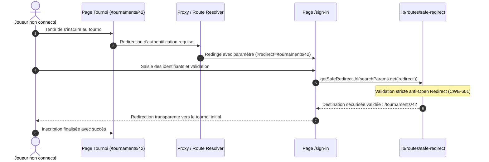

# 🏗️ Architecture Globale — Games-Trafics

> **Games-Trafics**  
> *"Joue, échange, domine — L'infini du gaming commence ici."*

Ce document constitue la référence centrale de l'architecture technique, fonctionnelle et sécuritaire de la plateforme Games-Trafics.

---

## 1. Stack Technique Réelle

- **Framework Web & API** : Next.js 16.4.3 (App Router, Turbopack, Partial Prefetching).
- **Langage** : TypeScript 5.x (Typage strict, sans régression).
- **Runtimes & Gestionnaire de Paquets** : Node.js LTS, Bun.
- **Base de Données & ORM** : PostgreSQL managé (Neon serverless) avec Drizzle ORM.
- **Authentification & Sessions** : Better-Auth (`auth.api.getSession`, cookies HTTP-Only sécurisés).
- **Chiffrement & Sécurité** : AES-256-GCM (`lib/encryption.ts`) pour les données sensibles (codes PIN, identifiants).
- **Interface & Design** : Tailwind CSS, Framer Motion, Lucide Icons, Radix UI.
- **Tests Automatisés** : Vitest (35 tests unitaires et d'intégration validés).

---

## 2. Structure des Répertoires et Responsabilités

```
games-trafics/
├── actions/                  # Server Actions Next.js (Mutations, transactions, tournois)
│   ├── README.md             # Documentation spécialisée des Server Actions
│   ├── tournaments.ts        # Gestion des tournois
│   ├── editions.ts           # Cycle de vie et gestion des éditions
│   ├── edition-registrations.ts # Point unifié pour les inscriptions
│   └── transactions.ts       # Opérations de portefeuille
├── app/                      # Next.js App Router (Pages, layouts, route handlers)
│   ├── README.md             # Documentation spécialisée des pages et layouts
│   ├── (auth)/               # Routes de connexion, inscription, réinitialisation
│   ├── (protected)/          # Espace membre sécurisé (Dashboard, Wallet, Profil)
│   ├── admin/                # Console d'administration
│   ├── api/                  # Route Handlers REST
│   │   └── README.md         # Documentation spécialisée des API
│   └── tournaments/          # Consultation et dashboard des tournois
├── components/               # Composants UI React
│   ├── cards/                # Cartes réutilisables (MemberCard, TournamentCard, MatchCard)
│   ├── layout/               # AppShell, MainLayout, LeftBar, TopMiddle
│   └── shared/               # Boutons partagés, dialogues de confirmation
├── config/                   # Configurations globales (routes-config.ts)
├── database/                 # Schéma PostgreSQL Drizzle (schema.ts)
├── hooks/                    # Hooks React personnalisés (use-auth, use-delete, etc.)
├── lib/                      # Services utilitaires (auth, encryption, safe-redirect)
├── proxy.ts                  # Point d'entrée proxy Next.js 16 (remplaçant du middleware)
└── tests/                    # Suites de tests Vitest (sécurité, wallet, permissions)
```

---

## 3. Schéma Global de l'Architecture

```mermaid
flowchart TD
    User([Utilisateur / Joueur]) -->|Requête HTTPS| Proxy[Next.js Proxy : proxy.ts]
    
    subgraph Routing_Security [Routage & Sécurité]
        Proxy -->|Résolution des droits| Resolver[Route Resolver : lib/routes/resolver.ts]
        Resolver -->|Contrôle session| BetterAuth[Better Auth Engine]
    end

    subgraph Presentation_Layer [Couche Présentation App Router]
        Proxy -->|Route Publique| PublicView[Pages Publiques : Accueil, Jeux, Clips]
        Proxy -->|Route Protégée| ProtectedLayout[Layout Protégé : app/(protected)/layout.tsx]
        Proxy -->|Route Admin| AdminLayout[Layout Admin : app/admin/layout.tsx]
        
        ProtectedLayout --> MemberViews[Dashboard, Wallet, Messagerie]
        AdminLayout --> AdminViews[Console Admin, Modération]
    end

    subgraph Data_Execution [Couche Métier & Données]
        MemberViews -->|Actions Mutex| ServerActions[Server Actions : actions/]
        MemberViews -->|Requêtes REST| ApiHandlers[API Route Handlers : app/api/]
        
        ServerActions --> DrizzleORM[Drizzle ORM]
        ApiHandlers --> DrizzleORM
        DrizzleORM --> PostgreSQL[(PostgreSQL Neon DB)]
    end
```

---

## 4. Flux d'Authentification, Autorisation et Redirection



---

## 5. Stratégie de Performance et de Cache

1. **Déduplication au rendu** : Utilisation de React Cache et des requêtes compilées pour éviter de solliciter plusieurs fois la base lors d'un même affichage.
2. **Navigation optimisée sans blocage** :
   - Le composant `AppShell` évalue les routes publiques sans bloquer leur rendu sur des vérifications privées.
   - L'étape optionnelle de bienvenue (`/welcome`) peut être omise via `skipWelcome=1`, `skip_welcome=true` ou `ignore_visite=true`.
3. **Revalidation sélective** : Les mutations financières et les inscriptions déclenchent uniquement l'invalidation des chemins concernés (`revalidatePath`), préservant les segments pré-rendus.

---

## 6. Sécurité des Données et Résilience

- **Contrôles côté serveur autoritaires** : Aucune décision d'autorisation ne se base sur l'état du client ou les paramètres d'URL.
- **Protection PIN** : Le code PIN du portefeuille n'est jamais stocké en clair ; il est chiffré via AES-256-GCM avec vecteur d'initialisation aléatoire et tag d'authentification cryptographique.
- **Isolation des Sessions** : Les contextes d'utilisateurs sont strictement compartimentés ; aucun cache serveur global ne partage de données de session entre deux requêtes distinctes.