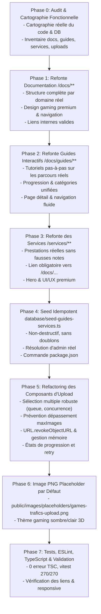

# IMPLEMENTATION PLAN — REFONTE DOCUMENTATION, GUIDES, SERVICES & SYSTÈME D’UPLOAD

Ce plan détaille la réalisation des 8 phases requises par `PROMPT.md` pour transformer la documentation, les guides interactifs, les services et les composants d'upload de Games-Trafics en un système de niveau production.

---

## Architecture des Phases

---

## Phase 0 — Audit & Cartographie Réelle (FAIT)

### 1. Cartographie Fonctionnelle Validée dans le Code
- **Authentification & Profils** : Better-auth avec passkeys, profils, avatars, vérification (`PENDING`, `VERIFIED`, `REJECTED`), rôles (`SELLER`, `BUYER`, `TRADER`, `TOURNAMENT_ORGANIZER`, `VIP`).
- **Wallet GTC & Finances** : Solde immuable ledger, types (`PURCHASE`, `VIP_SUBSCRIPTION`, `GAME_ITEM_PURCHASE`, `THEME_PURCHASE`, `DEPOSIT`, `WITHDRAWAL`, `REFUND`, `TRANSFER`, `ORDER_PURCHASE`, `TOURNAMENT_PARTICIPATION`, `BONUS`), statuts (`PENDING`, `COMPLETED`, `PROCESSING`, `FAILED`, `REFUNDED`), PIN de sécurité, QR codes transactionnels.
- **Marketplace & Boutiques** : Boutiques marchandes, produits avec statuts (`NON_VENDU`, `RESERVE`, `EN_ECHANGE`, `LIVRE`, `VENDU`, `ANNULER`), commandes et suivi vendeur/acheteur.
- **Jeux & Game Items** : 5 types réels (`COIN`, `ITEM`, `SKIN`, `EQUIPMENT`, `CURRENCY`), univers de jeu (Football, FPS, BR, Racing), demandes d'achat instantanées ou escrow.
- **Tournois & Compétitions** : Éditions, inscriptions individuelles et par équipe, formats (`ELIMINATION`, `GROUP_STAGE`, `ROUND_ROBIN`, `SWISS`, `KNOCKOUT`), brackets, petite finale (3e place), scores, classements, révélation hiérarchique en 3 temps narratifs.
- **Équipes & Communauté** : Équipes multi-rôles (`CAPTAIN`, `PLAYER`, `COACH`, etc.), clips vidéo avec player interactif, publications, commentaires, messagerie directe et groupes, annonces et notifications.
- **Abonnements VIP & Partenaires** : Plans VIP mensuel/annuel/à vie, badges or, réductions de frais.

---

## Phase 1 — Refonte Documentation `/docs/**`
1. Créer et enrichir les fichiers Markdown structurés dans `docs/content/` :
   - `getting-started.md` (Bienvenue, vision GTC, navigation, rôles)
   - `account/overview.md`, `account/security.md` (Création, passkeys, vérification)
   - `wallet/overview.md`, `wallet/transactions.md`, `wallet/security.md` (Solde, dépôts, retraits, transferts, PIN)
   - `marketplace/overview.md`, `marketplace/shops.md`, `marketplace/orders.md` (Boutiques, publication, commande, litiges)
   - `games/overview.md`, `games/items.md` (Catalogue, types d'items, monnaies, skins)
   - `tournaments/overview.md`, `tournaments/organizers.md`, `tournaments/brackets.md`, `tournaments/matches.md` (Formats, brackets, scores, 3e place)
   - `teams/overview.md` (Création d'équipe, gestion des membres)
   - `community/clips.md`, `community/messaging.md` (Clips, chat, annonces)
   - `vip/overview.md` (Avantages et gestion)
2. Moderniser `app/docs/page.tsx` et `components/docs/sidebar.tsx` : navigation sticky fluide, recherche par mots-clés, callouts interactifs, responsive mobile & desktop.

---

## Phase 2 — Refonte des Guides Interactifs `/docs/guides/**`
1. Aligner les catégories de guides : `debutant`, `wallet`, `tournois`, `boutique`, `jeux`, `equipes`, `vip`.
2. Refondre `app/docs/guides/page.tsx` et `app/docs/guides/[guideId]/page.tsx` :
   - Interface étape par étape avec progression dynamique.
   - Lien direct vers la documentation officielle correspondante (`/docs/...`).
   - Responsive optimisé (drawer/sheet tactile sur mobile).

---

## Phase 3 — Refonte des Services `/services/**`
1. Refondre `app/services/page.tsx` :
   - Supprimer les fausses mentions ("Coaching intensif", "Boost", "Design freelance", etc.).
   - Mettre en valeur les vraies prestations d'accompagnement de Games-Trafics :
     * *Assistance à l'Organisation de Tournois E-Sport*
     * *Accompagnement Création & Certification de Boutique*
     * *Sécurisation de Compte & Intégration Wallet GTC*
     * *Support Technique Événementiel & Compétitions*
2. Refondre `app/services/[id]/page.tsx` :
   - Supprimer les faux avis "5.0 Rating", "Garanti 100%", "24h/7j".
   - Remplacer le faux bouton "Commander Maintenant" par une prise de contact claire vers `/support` ou messagerie interne.
   - **Ajouter la section obligatoire "Comprendre la fonctionnalité" avec lien explicite vers `/docs/...`**.

---

## Phase 4 — Seed Idempotent `database/seed-guides-services.ts`
1. Créer `database/seed-guides-services.ts` :
   - Récupérer les guides et services existants.
   - Insérer uniquement les éléments manquants (clés stables / slugs uniques).
   - Trouver un administrateur réel en base pour `adminId`.
   - Ne jamais écraser les données modifiées manuellement.
2. Ajouter le script dans `package.json` : `"db:seed:guides-services": "tsx database/seed-guides-services.ts"`.

---

## Phase 5 — Refactoring des Composants d'Upload
1. **`components/ui/advanced-multi-upload.tsx`** :
   - File d'attente d'upload avec contrôle de concurrence (max 3 uploads simultanés).
   - Contrôle strict de `maxImages` incluant `value.length + uploadingFiles.length + incomingFiles.length`.
   - Remplacement de `alert()` par `toast.error()`.
   - Éviter la fermeture périmée (`stale closure`) via fonction de mise à jour d'état ou ref.
   - Libération propre des URLs mémoire avec `URL.revokeObjectURL`.
   - Possibilité de réessai individuel pour un fichier en erreur.
2. **`components/ui/advanced-upload.tsx`** :
   - Gestion d'état claire (compression, upload, succès, erreur).
   - Nettoyage mémoire au démontage.
3. **`components/ui/advanced-video-upload.tsx`** :
   - Validation stricte des formats et tailles vidéo.
   - Progression réelle avec XHR.

---

## Phase 6 — Image PNG Placeholder par Défaut
- Créer `public/images/placeholders/games-trafics-upload.png` : visuel gaming 3D premium avec logo GT, utilisable pour les sélecteurs de médias vides.

---

## Phase 7 & 8 — Tests, Qualité & Documentation
- `bunx tsc --noEmit` → 0 erreurs.
- `bunx eslint` → 0 erreurs.
- `vitest run tests/unit` → 270/270 tests passés.
- Rapport final détaillé.
