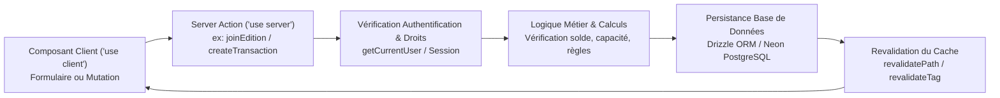

# ⚡ Documentation des Server Actions — Games-Trafics

Ce document détaille les actions serveur Next.js situées dans le dossier actions/.
Les Server Actions constituent la couche d'exécution privilégiée des mutations de données et de la logique métier côté serveur dans Games-Trafics.

---

## 1. Organisation des Domaines Métier

| Fichier | Domaine | Principales Opérations | Rôles / Autorisations |
|---|---|---|---|
| actions/tournaments.ts | Tournois | createTournament, updateTournament, deleteTournament, getTournaments | Création/Édition : Organisateur, Membre |
| actions/editions.ts | Éditions de tournois | joinEdition, updateEdition, deleteEdition, reorderPhasesAction | Gestion : Organisateur / Inscription : Membre |
| actions/edition-registrations.ts | Inscriptions d'éditions | Point central : joinEdition, addEditionParticipantAction, deleteEditionRegistrationAction | Membre authentifié avec solde suffisant |
| actions/phases.ts | Phases & Arbres (Brackets) | getMatchesWithParticipants, génération des matchs, avancement | Organisateur du tournoi |
| actions/transactions.ts | Portefeuille & Finance | Transferts, rechargement, vérification PIN, transactions QR | Propriétaire du portefeuille avec PIN chiffré valide |
| actions/shops.ts | Boutiques & Marketplace | Création de boutique, mise à jour, articles en vente | Vendeur / Admin |
| actions/orders.ts | Commandes & Livraisons | Passer commande, suivi du statut, annulation | Acheteur / Vendeur concerné |
| actions/users.ts | Utilisateurs & Profils | Mise à jour du profil, avatar, paramètres de notification | Utilisateur concerné |

---

## 2. Diagramme Mermaid des Appels Server Actions

---

## 3. Bonnes Pratiques et Règles Obligatoires

1. Directive `'use server'` : Tout fichier ou fonction d'action doit déclarer la directive au sommet.
2. Validation systématique : Ne jamais faire confiance aux arguments reçus du client ; toujours valider avec un schéma Zod ou des contraintes strictes.
3. Contrôle d'accès côté serveur : Les droits de l'utilisateur (propriété de la ressource, rôle admin) doivent être vérifiés dans l'action, indépendamment de l'état du client.
4. Gestion des retours : Renvoyer des objets normalisés de forme `{ success: boolean, data?: T, error?: string }` pour simplifier la gestion des toasts côté client.
5. Revalidation ciblée : Utiliser revalidatePath uniquement pour les chemins modifiés afin de préserver l'efficacité du cache Next.js.