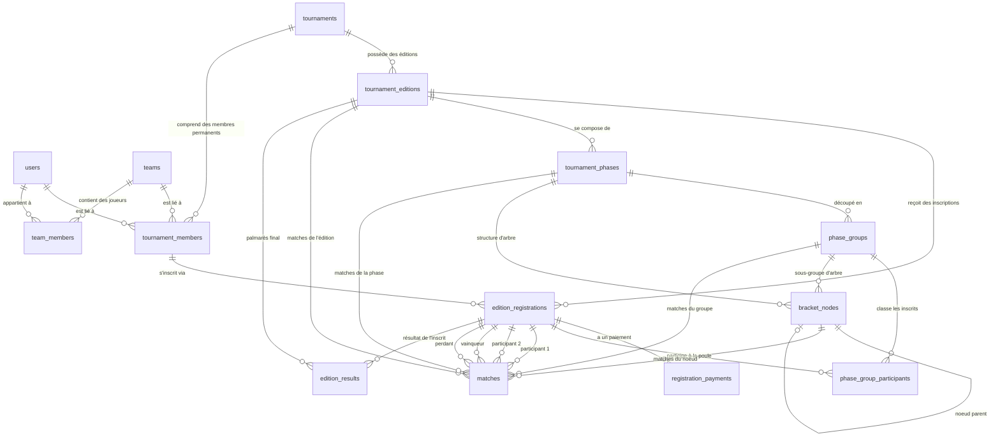

# Document 03 — Audit Technique de l'Architecture Actuelle de Games Trafics

Ce document dresse un état des lieux exhaustif et rigoureux de l'implémentation actuelle du moteur de compétition de Games Trafics. Tous les constats s'appuient directement sur le code source réel du dépôt.

---

## 1. Modèle de Données Existant (Schéma Drizzle)

Le système de compétition repose actuellement sur 11 tables principales définies dans `database/schema.ts` :

### Diagramme Entité-Relation Actuel (Mermaid)

---

## 2. Analyse Détaillée des Tables et Relations

### A. Niveau Compétition et Édition
* **`tournaments` (`schema.ts:994`) :** Conteneur parent. Définit l'identité du tournoi (`name`, `game`, `platform`, `gameMode`, `allowedTeams`, `organizerId`).
  * *Points d'attention :* Les règles, formats et codes de conduite sont fixés au niveau du tournoi parent, mais certaines éditions peuvent avoir des règles divergentes.
* **`tournament_editions` (`schema.ts:1075`) :** L'instance temporelle de l'événement (`editionNumber`, `startDate`, `endDate`, `prizePool`, `entryFee`, `editionConfig`).
  * *Champ `editionConfig` (jsonb) :* Stocke `competitionType` (`LDC`, `CHAMPIONSHIP`, `CUP`, `SWISS`), `competitionMode` (`AUTO`, `MANUAL`), `checkinRequired`, `tiebreakerRules`.
  * *Lien financier :* `financialAccountId` pointe vers le compte dédié du prize pool.

### B. Niveau Participants et Inscriptions
* **`tournament_members` (`schema.ts:1161`) :** Entité permanente attachée au tournoi parent.
  * Référence soit `userId` soit `teamId`.
  * Rôles : `PARTICIPANT`, `ORGANIZER`, `CO_ORGANIZER`, `REFEREE`, `SPECTATOR`.
  * *Contrainte d'unicité :* Unicité par `(tournamentId, userId)` et `(tournamentId, teamId)`.
* **`edition_registrations` (`schema.ts:1243`) :** L'inscription concrète à une édition.
  * Référence obligatoire : `editionId` et `memberId`.
  * Statuts (`participationStatusEnum`) : `PENDING`, `REGISTERED`, `CONFIRMED`, `CHECKED_IN`, `DISQUALIFIED`, `CANCELLED`.
  * Frais : `registrationFee`, `feePaid`, `paymentTransactionId`.

### C. Niveau Phases, Groupes et Arbres
* **`tournament_phases` (`schema.ts:1343`) :** Découpe l'édition en étapes ordonnées (`order`, `phaseType`).
  * `phaseType` (`tournamentFormatEnum`) : `ELIMINATION`, `GROUP_STAGE`, `ROUND_ROBIN`, `SWISS`, `KNOCKOUT`, `CUSTOM`.
  * `config` (jsonb) : `advanceFromGroup`, `qualifiedCount`, `groupsCount`, `seedingMethod`, `tiebreaker`.
* **`phase_groups` (`schema.ts:1395`) :** Groupe ou poule rattaché à une phase.
  * `groupType` : `ROUND_ROBIN`, `ELIMINATION`.
  * *Anomalie architecturale identifiée :* Dans les championnats (League), chaque journée est modélisée comme une ligne dans `phase_groups` (`name: "Journée 1"`, `config.isMatchday = true`) dans `lib/tournaments/generators.ts:92-113`.
* **`phase_group_participants` (`schema.ts:1436`) :** Table pivot liant `phase_groups` et `edition_registrations`.
  * Maintient les statistiques de groupe dénormalisées : `matchesPlayed`, `matchesWon`, `matchesDrawn`, `matchesLost`, `points`, `scoreFor`, `scoreAgainst`, `scoreDifference` (colonne générée `score_for - score_against`), `position`, `qualified`.
* **`bracket_nodes` (`schema.ts:1481`) :** Modélisation de l'arbre éliminatoire.
  * Nœud auto-référencé (`parentNodeId`) avec `depth`, `order`, `bracketType` (`UPPER`, `LOWER`, `FINAL`, `CONSOLATION`), `round`, `matchNumber`.
  * Référence `winnerRegistrationId`.

### D. Niveau Match et Résultats
* **`matches` (`schema.ts:1530`) :** La source unique de vérité actuelle pour toute confrontation.
  * Clés étrangères vers `editionId`, `phaseId`, `groupId`, `bracketNodeId`.
  * **Champs de participants rigides :**
    * `participant1RegistrationId: text`
    * `participant2RegistrationId: text`
    * `score1: integer`
    * `score2: integer`
    * `winnerRegistrationId: text`
    * `loserRegistrationId: text`
  * Statuts (`matchStatusEnum`) : `PENDING`, `IN_PROGRESS`, `COMPLETED`, `CANCELLED`, `DISPUTED`, `AWAITING_ADMIN_CONFIRMATION`, `PENDING_REVIEW`, `BYE`, `FINISHED`.
  * Validation : `confirmedByParticipant1`, `confirmedByParticipant2`, `confirmedByAdmin`.
  * Détails : `gameData: jsonb`, `screenshot`, `proofLinks`.

---

## 3. Analyse des Moteurs Métier (`lib/tournaments/`)

### A. Générateur de Structure et de Matchs
* **`structure-engine.ts` & `generators.ts` :**
  * `createStructureEngine()` construit la structure complète lors de la création ou du tirage au sort.
  * Gère 4 générateurs principaux : `setupLeaguePhase()`, `setupGroupPhase()`, `setupEliminationGroups()`, `setupSwissPhase()`.
  * Utilise des identifiants temporaires de placeholder (`QUALIFIER_1`, `WINNER_A1`, etc.) via `isPlaceholder()` pour pré-créer les arbres de playoffs avant que les qualifications ne soient effectives.
* **`match-generation-engine.ts` & `match.generator.ts` :**
  * Implémente l'algorithme Round-Robin (algorithme du ruban de Berger) pour générer les rencontres simples ou aller-retour (`buildLeagueCalendar()`).
  * Génère les confrontations d'arbres éliminatoires (`generateEliminationMatches()`).

### B. Moteur de Progression et Propagation
* **`progression-engine.ts` (755 lignes) :**
  * Fonction clé : `progressTournamentAfterMatch(matchId: string)`.
  * Vérifie successivement la complétion du nœud de bracket, la complétion du groupe, puis la complétion de la phase.
  * En mode `AUTO`, propage automatiquement le vainqueur au tour suivant via `handleEliminationProgression()`.
* **`propagation-service.ts` :**
  * Propage les qualifiés d'une phase terminée vers la phase suivante (`propagatePhaseResults()`).
  * Résout les placeholders et remplace les `QUALIFIER_X` par les véritables `registrationId` des vainqueurs de poules.

### C. Moteur de Classement et de Qualification
* **`standings.engine.ts` :**
  * `syncStandingsWithMatches()` recalcule les classements à la volée depuis la table `matches` pour éviter toute dérive d'état.
  * `rankParticipants()` applique les critères de départage configurés (`tiebreakerRules: ["POINTS", "GOAL_DIFF", "GOALS_FOR"]`).
* **`scoring.ts` :**
  * Hiérarchie de résolution : `group.config` -> `phase.config` -> `SCORING_DEFAULTS` (3 points pour victoire, 1 pour nul, 0 pour défaite).
* **`qualification.ts` :**
  * Module pur résolvant le nombre d'avancées par groupe (`resolveQualification()`) selon la priorité : Groupe -> Phase -> Édition -> Format Default.

### D. Moteur Visuel des Playoffs
* **`playoffs-engine.ts` & `playoffs-image-export.ts` :**
  * Reconstruit une arborescence symétrique ("THE PLAYOFFS" avec aile gauche, aile droite et finale au centre).
  * Exporte en image PNG/JPEG de haute résolution avec canvas pour les réseaux sociaux.

---

## 4. Bilan des Forces de Games Trafics

1. **Isolation Financière Exemplaire :** Les transactions de wallets (`walletTransactions`) et les paiements d'inscriptions (`registrationPayments`) sont strictement séparés de la logique sportive.
2. **Source de Vérité des Matchs Robuste :** Le recalcul dynamique des classements (`syncStandingsWithMatches`) à partir des matchs réels élimine les incohérences de base de données.
3. **Moteur Visuel d'Arbre Performant :** La représentation symétrique des playoffs et la génération d'images pour le partage social offrent une expérience utilisateur supérieure à de nombreux concurrents.
4. **Système de Notification Intégré :** Les arbitres et participants reçoivent des alertes temps réel par WhatsApp, Web Push et Email.
5. **Support des Matchs Aller-Retour :** Algorithmes déjà fonctionnels pour le calcul des scores agrégés et des tirs au but dans les brackets.

---

## 5. Bilan des Faiblesses et Limites Architecturales Majeures

| N° | Limitation Identifiée | Fichiers / Tables Concernés | Conséquence Métier |
|:---|:---|:---|:---|
| **1** | **Structure de Match binaire (2 participants max)** | `matches` (`participant1RegistrationId`, `participant2RegistrationId`, `score1`, `score2`) | **Incapacité totale** à gérer les Battle Royale (PUBG, Free Fire, Warzone), les courses (Asphalt) ou tout format FFA à plus de 2 joueurs. |
| **2** | **Absence de découplage Confrontation vs Manche (Match vs Game)** | `matches` (`gameData: jsonb`) | Les Best-of-3 et Best-of-5 sont forcés soit dans un JSON non requêtable, soit dans des lignes de match indépendantes sans lien parent-enfant formel. |
| **3** | **Surcharge sémantique de `phase_groups`** | `phase_groups`, `lib/tournaments/generators.ts:92` | Les journées de championnat (`isMatchday = true`) sont stockées comme des poules, brouillant la distinction entre "groupe de classement" et "calendrier de jeu". |
| **4** | **Absence de Roster figé par Édition** | `teams`, `team_members`, `tournament_members` | Si un joueur quitte une équipe sur la plateforme, les anciennes éditions jouées par cette équipe perdent la composition exacte qui avait participé. |
| **5** | **Gestion fragile des participants invités (Non-Users)** | `actions/editions.ts:672` (`addEditionParticipantAction`) | Pour ajouter un joueur sans compte, le système crée un faux `tournamentMember` orphelin (`userId: null`), polluant le répertoire des membres du tournoi. |
| **6** | **Vocabulaire et barème implicitement footballistiques** | `phase_group_participants` (`score_for`, `score_against`, `score_difference`), `scoring.ts` | Incapacité à valoriser nativement des systèmes à points de survie/placement + kills, des chronomètres au millième, ou des rounds de combat. |
| **7** | **Modélisation de bracket par duplication de données** | `bracket_nodes` et `matches` | Double stockage des statuts (`is_completed`, `winner_registration_id` dans les deux tables), créant un risque de désynchronisation en cas d'erreur de transaction. |
