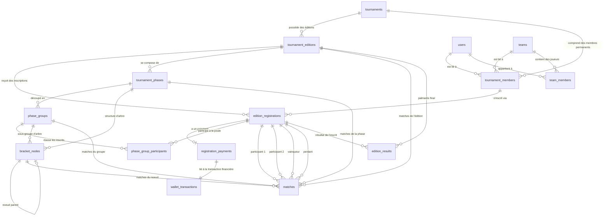

# Document 03 — Audit Technique de l'Architecture Actuelle de Games Trafics (Révisé)

Ce document dresse un état des lieux exhaustif et rigoureux de l'implémentation actuelle du moteur de compétition de Games Trafics, vérifié directement sur le code source réel du dépôt.

---

## 1. Modèle de Données Existant (Schéma Drizzle)

Le système de compétition repose actuellement sur 11 tables principales définies dans `database/schema.ts` :

### Diagramme Entité-Relation Actuel (Mermaid)



---

## 2. Analyse Critique des Tables et Dépendances Financières

### A. Dépendances Critiques : Inscriptions vs Traçabilité Financière
Une analyse minutieuse des relations entre l'aspect sportif et l'aspect financier révèle un couplage fort à risque :
* **`registration_payments` (`schema.ts:1311`) :**
  ```ts
  registrationId: text('registration_id').notNull().references(() => editionRegistrations.id, { onDelete: 'cascade' }),
  transactionId: text('transaction_id').notNull().references(() => walletTransactions.id),
  ```
* **`wallet_transactions` (`schema.ts:275`) :** Enregistre les débits/crédits réels sur les wallets des utilisateurs (`GTC`), liés à un `financialAccountId` (compte escrow ou pool de tournoi).
* **Risque identifié lors d'une purge :** À cause de `onDelete: 'cascade'` sur `edition_registrations`, une suppression directe (`DELETE FROM tournament_editions` ou `DELETE FROM edition_registrations`) supprimerait automatiquement les enregistrements de `registration_payments`. Bien que les lignes de `wallet_transactions` subsistent, **le lien d'audit comptable expliquant la raison du débit de l'utilisateur serait définitivement perdu**.
* **Recommandation :** Toute refonte ou suppression des anciennes données doit archiver ou découpler `registration_payments` pour préserver l'auditabilité financière.

### B. Confusion entre Staff et Participants dans `tournament_members`
* Dans `schema.ts:1161`, la table `tournament_members` mélange les participants sportifs avec les rôles organisationnels (`role`: `ORGANIZER`, `CO_ORGANIZER`, `REFEREE`, `PARTICIPANT`, `SPECTATOR`, `COMMENTATOR`).
* Cela crée une ambiguïté majeure : un arbitre ou un organisateur est forcé de coexister dans la même table que les compétiteurs, sans séparation claire entre les droits de gestion et les entités en compétition.

### C. Absence de distinction entre Club de Jeu et Équipe Réelle
* Le champ `clubName` dans `tournament_members` ou `teams` mélange deux réalités distinctes :
  1. **L'équipe compétitive réelle :** Une structure d'esports (ex. *FC Douane*, *Team Vitality*), dotée de membres humains, d'un capitaine et d'un palmarès.
  2. **L'équipe / club sélectionné dans le jeu vidéo :** Un choix de roster in-game (ex. *Real Madrid*, *Manchester City* sur EA Sports FC ou eFootball), qui n'est qu'un attribut cosmétique / d'équipement temporaire choisi par le joueur pour un match ou une édition.

---

## 3. Analyse Critique des Moteurs Métier et Rectifications

### A. Rectification sur le Départage dans `standings.engine.ts`
> [!IMPORTANT]
> **Correction de l'audit précédent :** Le code réel de `rankParticipants()` dans `lib/tournaments/standings.engine.ts:117-130` **n'implémente pas** le critère `HEAD_TO_HEAD` (confrontation directe).

Voici le code exact extrait du fichier :
```ts
return list.sort((a, b) => {
    for (const rule of finalConfig.tiebreakerRules) {
        if (rule === "POINTS" && a.stats.points !== b.stats.points) {
           return b.stats.points - a.stats.points;
        }
        if (rule === "GOAL_DIFF" && a.stats.scoreDifference !== b.stats.scoreDifference) {
           return b.stats.scoreDifference - a.stats.scoreDifference;
        }
        if (rule === "GOALS_FOR" && a.stats.scoreFor !== b.stats.scoreFor) {
           return b.stats.scoreFor - a.stats.scoreFor;
        }
    }
    return 0;
});
```
**Constat :** Même si `HEAD_TO_HEAD` est mentionné dans le tableau par défaut de `types.ts` ou dans des enums, l'algorithme de tri ignore complètement cette règle et ne traite que `POINTS`, `GOAL_DIFF` et `GOALS_FOR`. Les égalités en confrontation directe ne sont donc actuellement **jamais résolues** par ce moteur.

### B. Surcharge Sémantique Confirmée de `phase_groups`
Dans `lib/tournaments/generators.ts:92-113`, lors de la génération d'un championnat (`setupLeaguePhase`), chaque journée de match génère une ligne distincte dans `phase_groups` :
```ts
const [group] = await tx.insert(phaseGroups).values({
    phaseId: phase.id,
    name: `${dayNamePrefix} ${day.day}`, // "Journée 1", "Journée 2"...
    groupType: "ROUND_ROBIN",
    config: inheritScoringToGroup(phaseConfig, {
        isMatchday: true,
        dayNumber: day.day,
        ...
    })
});
```
Cette conception crée une confusion conceptuelle : les journées (unités temporelles) sont stockées dans la même table que les poules (unités de classement).

### C. Modèle de Match Binaire Figeant l'Écosystème
Dans `schema.ts:1530`, les colonnes `participant1RegistrationId`, `participant2RegistrationId`, `score1`, `score2` bloquent irrémédiablement le support :
* Des Battle Royale (16 à 25 escouades dans la même manche).
* Des courses (8 pilotes dans la même session).
* Des confrontations collectives inter-régions ou guerres de clans (Région A vs Région B avec 5 sous-duels simultanés).

---

## 4. Synthèse des Vulnérabilités de l'Architecture Actuelle

1. **Intégrité Financière en Cas de Purge :** La suppression en cascade de `edition_registrations` détruit `registration_payments`, effaçant l'explication des débits réels du ledger.
2. **Scoring et Départage Incomplets :** Absence de `HEAD_TO_HEAD` réel, barème footballistique non adaptable aux jeux à éliminations multiples ou à chronomètres.
3. **Absence de Notion de Roster Figé :** La composition d'équipe repose sur `team_members` global, rendant impossible l'historisation exacte des équipes d'une édition passée.
4. **Absence de Support pour les Confrontations Collectives :** Aucun moyen de regrouper plusieurs matchs 1v1 ou 2v2 sous une bannière commune (ex. Dakar vs Abidjan).
5. **Slots de Brackets Simples et Non Relationnels :** La progression s'appuie sur des placeholders textuels (`QUALIFIER_1`, `WINNER_A1`) plutôt que sur un graphe relationnel de dépendances (DAG).
