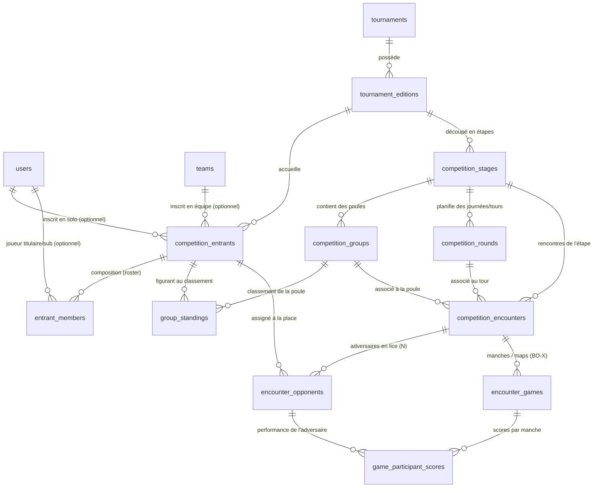
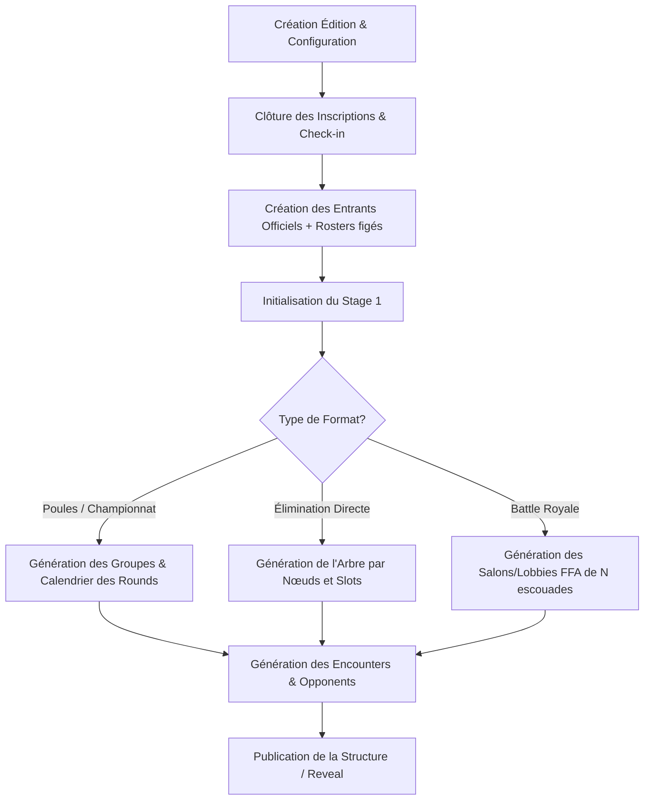
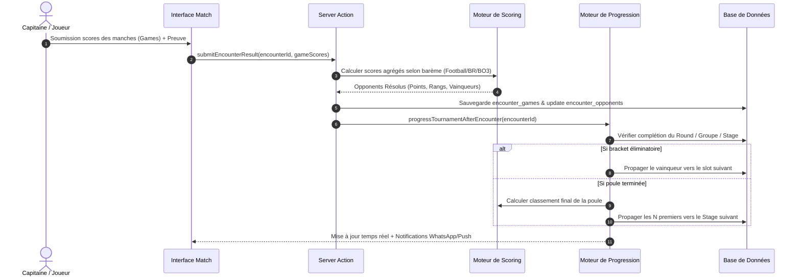

# Document 05 — Proposition d'Architecture Cible Universelle pour Games Trafics

Ce document présente l'architecture cible recommandée pour transformer Games Trafics en un moteur de compétition universel, robuste et hautement évolutif.

---

## 1. Principes Fondateurs de l'Architecture Cible

1. **Règle de l'Entrant Unique :** Un match ne manipule jamais directement des utilisateurs (`users`) ou des équipes (`teams`), mais exclusivement des **Entrants** (`competition_entrants`). Un Entrant encapsule le participant officiel d'une édition donnée (solo, duo, squad ou club).
2. **Roster Figé par Édition :** La composition d'une équipe est instanciée et verrouillée au moment de l'inscription à l'édition (`entrant_members`). Elle ne subit pas les changements ultérieurs de l'équipe sur la plateforme.
3. **Opposition N-aire (Opponents) :** Tout match réunit une collection d'adversaires (`encounter_opponents`). Un duel est un cas particulier où $N = 2$. Un Battle Royale est un cas où $N = 16$ à $100$. Une course est un cas où $N = 8$.
4. **Découpage Confrontation / Manche (Encounter / Game) :** Une série de compétition (BO1, BO3, BO5 ou session de 4 cartes BR) est une confrontation (`encounter`), découpée en manches élémentaires (`encounter_games`).
5. **Découplage Poule vs Calendrier (Group vs Round) :** Une poule (`group`) est un conteneur de classement et de qualification. Une journée (`round`) est une unité temporelle de calendrier.
6. **Moteur de Scoring Abstrait (Strategy Pattern) :** Le calcul des points et des départages est délégué à des modules de règles spécialisés selon la discipline du jeu.

---

## 2. Modèle de Données Cible (Diagramme Entité-Relation Mermaid)

---

## 3. Spécification Détaillée des Entités Cibles

### A. Gestion des Participants : `competition_entrants` & `entrant_members`

#### `competition_entrants` (L'entité compétitrice officielle)
Remplace le couple ambigu `tournament_members` / `edition_registrations` comme référence sportive dans les matchs.
* `id` : UUID (Primary Key).
* `edition_id` : UUID (FK vers `tournament_editions`).
* `type` : Enum (`INDIVIDUAL`, `TEAM`).
* `user_id` : UUID (Optionnel, FK vers `users`, si joueur solo inscrit).
* `team_id` : UUID (Optionnel, FK vers `teams`, si équipe inscrite).
* `name` : String (Nom d'affichage officiel pour l'édition, ex. *"Team Vitality"* ou *"ShadowNinja"*).
* `tag` : String (Tag d'équipe ou préfixe de sponsor, ex. *"VIT"*).
* `logo` : String (URL de l'image de compétition).
* `seed` : Integer (Numéro de tête de série dans l'édition).
* `status` : Enum (`PENDING`, `CONFIRMED`, `CHECKED_IN`, `DISQUALIFIED`, `WITHDRAWN`).
* `custom_fields` : JSONB (Champs requis par l'organisateur : Riot ID, Gamertag, Téléphone WhatsApp, etc.).
* `registration_payment_id` : UUID (Lien direct et immuable vers le paiement du wallet).

#### `entrant_members` (Le Roster figé de l'édition)
Permet de figer qui a joué pour cette équipe lors de cette édition spécifique, sans risque d'altération si l'équipe change ses membres plus tard.
* `id` : UUID (Primary Key).
* `entrant_id` : UUID (FK vers `competition_entrants`, cascade).
* `user_id` : UUID (Optionnel, FK vers `users`, nul si joueur invité sans compte).
* `in_game_name` : String (Pseudo exact dans le jeu).
* `in_game_id` : String (Identifiant en jeu : UID Free Fire, Tag Activision, etc.).
* `role` : Enum (`CAPTAIN`, `STARTER`, `SUBSTITUTE`, `COACH`).
* `is_verified` : Boolean.

---

### B. Découpage Structurel : Stages, Groups et Rounds

#### `competition_stages` (Les grandes étapes)
* `id` : UUID.
* `edition_id` : UUID.
* `name` : String (ex. *"Phase de Groupes"*, *"Playoffs - Double Élimination"*, *"Lobby Final BR"*).
* `stage_type` : Enum (`ROUND_ROBIN`, `SINGLE_ELIMINATION`, `DOUBLE_ELIMINATION`, `SWISS`, `BATTLE_ROYALE_LADDER`, `CUSTOM`).
* `order` : Integer (1, 2, 3...).
* `settings` : JSONB (Règles spécifiques d'avancée vers l'étape suivante).

#### `competition_groups` (Les groupes de niveau / poules)
* `id` : UUID.
* `stage_id` : UUID.
* `name` : String (ex. *"Poule A"*, *"Poule B"*, ou *"Arbre Principal"*).
* `order` : Integer.
* `settings` : JSONB (Barème de scoring propre au groupe).

#### `competition_rounds` (Les journées / tours de jeu)
Résout définitivement la surcharge des championnats !
* `id` : UUID.
* `stage_id` : UUID.
* `round_number` : Integer (1, 2, 3...).
* `name` : String (ex. *"Journée 1"*, *"Quarts de Finale"*, *"Manche 3"*).
* `scheduled_date` : Timestamp.

---

### C. Modèle Universel de Confrontation : `competition_encounters` & `encounter_opponents`

#### `competition_encounters` (La Confrontation / Série)
* `id` : UUID.
* `stage_id` : UUID.
* `group_id` : UUID (Optionnel).
* `round_id` : UUID (Optionnel).
* `code` : String (ex. *"M01"*, *"WB-R1-M2"*).
* `format` : Enum (`DUEL`, `FFA`).
* `match_format` : Enum (`BEST_OF_1`, `BEST_OF_3`, `BEST_OF_5`, `TWO_LEGS_AGGREGATE`, `POINTS_ACCUMULATION`).
* `status` : Enum (`PENDING`, `READY`, `IN_PROGRESS`, `COMPLETED`, `DISPUTED`, `CANCELLED`).
* `scheduled_time` : Timestamp.
* `winner_entrant_id` : UUID (Optionnel, raccourci pour les duels).

#### `encounter_opponents` (La collection des N adversaires)
Permet de modéliser un duel ($N=2$) comme un Battle Royale ($N=60$).
* `id` : UUID.
* `encounter_id` : UUID (FK vers `competition_encounters`).
* `entrant_id` : UUID (Optionnel, null si slot d'arbre en attente de qualification).
* `slot_origin` : JSONB (ex. `{"type": "WINNER_OF", "encounter_code": "M01"}` pour les brackets).
* `position` : Integer (Position du slot : 1, 2 dans un duel ; 1 à 20 dans un BR).
* `final_score` : Numeric (Score global de la confrontation, ex. 2 à 1 en BO3, ou 45 points en BR).
* `final_rank` : Integer (1er, 2e, 3e... dans la confrontation).
* `result` : Enum (`WIN`, `LOSS`, `DRAW`, `QUALIFIED`, `ELIMINATED`, `FORFEIT`).

---

### D. Découpage en Manches Élémentaires : `encounter_games` & `game_participant_scores`

#### `encounter_games` (La Manche / Carte)
* `id` : UUID.
* `encounter_id` : UUID.
* `game_number` : Integer (1, 2, 3...).
* `map_name` : String (ex. *"Bermuda"*, *"Standoff"*, *"Erangel"*).
* `status` : Enum (`PENDING`, `IN_PROGRESS`, `COMPLETED`).
* `proof_screenshot` : String.
* `replay_data` : JSONB.

#### `game_participant_scores` (Les statistiques par manche)
* `id` : UUID.
* `game_id` : UUID.
* `opponent_id` : UUID (FK vers `encounter_opponents`).
* `score` : Integer (Score principal de la manche, ex. buts ou rounds gagnés).
* `placement` : Integer (Pour les BR : rang de survie, ex. Top 1, Top 5).
* `kills` : Integer (Pour les FPS/BR : éliminations réalisées).
* `stats` : JSONB (Dégâts, temps de survie, passes décisives, etc.).
* `calculated_points` : Numeric (Points attribués pour cette manche selon le barème).

---

## 4. Diagrammes des Flux Fonctionnels

### A. Flux de Génération de Tournoi

### B. Flux de Validation de Résultat et Progression

---

## 5. Support Natif des Formats selon la Discipline

### 1. Format Football / Sport (eFootball, EA Sports FC)
* Confrontation en Duel ($N=2$) : match simple ou match Aller-Retour agrégé (`TWO_LEGS_AGGREGATE`).
* Moteur de scoring : 3 points par victoire, 1 par nul, 0 par défaite. Départage : Points -> Confrontation directe -> Différence de buts -> Buts marqués.

### 2. Format FPS / Arène par équipe (COD Mobile, Valorant)
* Confrontation en Duel ($N=2$), match en Best-of-3 ou Best-of-5.
* Chaque `game` représente une carte avec mode de jeu spécifique.
* Score du match : nombre de cartes remportées.

### 3. Format Battle Royale (PUBG Mobile, Free Fire)
* Confrontation en mode FFA ($N=16$ à $25$ escouades).
* Série de 4 ou 6 manches (`games`) sur des cartes différentes (ex. Bermuda, Purgatory, Kalahari).
* Barème officiel esports :
  * Top 1 : 12 pts, Top 2 : 9 pts, Top 3 : 8 pts, Top 4 : 7 pts, Top 5 : 6 pts, etc.
  * Chaque kill = 1 pt supplémentaire.
* Le vainqueur de la confrontation est l'escouade ayant accumulé le plus de points sur l'ensemble des manches.

### 4. Format Course / Racing (Asphalt 9)
* Poule de 8 coureurs ($N=8$).
* Série de 3 courses.
* Barème par position (1er: 10 pts, 2e: 8 pts, 3e: 6 pts, etc.) avec conservation des chronomètres au millième en métadonnées.
