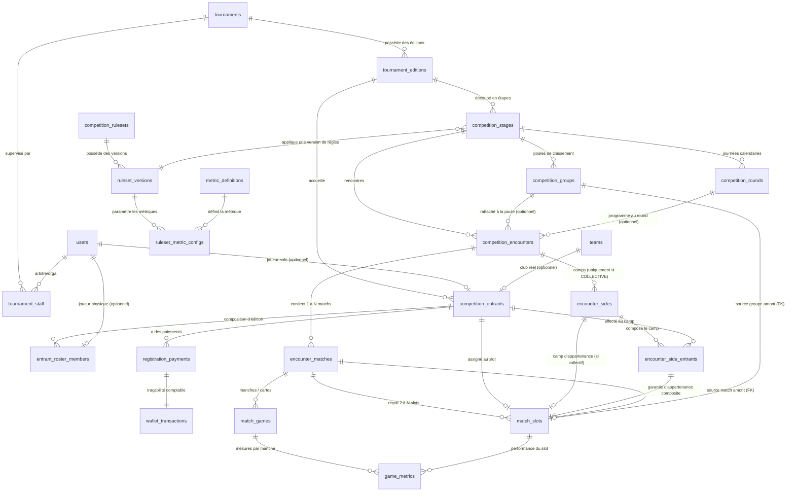

# Document 05 — Proposition d'Architecture Cible Universelle (Spécification Définitive et Complète)

Ce document constitue la référence formelle, exhaustive et validée de l'architecture cible du système de compétition de Games Trafics. Il définit l'ensemble des tables, colonnes, cardinalités, contraintes SQL composites d'intégrité et démontre concrètement la prise en charge de l'ensemble des formats compétitifs.

---

## 1. Principes Directeurs et Séparation des Responsabilités

Le modèle relationnel garantit 6 séparations strictes :
1. **Identité Globale (`users`, `teams`, `team_members`) :** Entités permanentes de la plateforme, intangibles et préservées lors de toute opération sur les tournois.
2. **Encadrement Administratif (`tournament_staff`) :** Arbitres, organisateurs et casters, formellement dissociés des compétiteurs.
3. **Entité Compétitive Unique (`competition_entrants`, `entrant_roster_members`) :** L'unique unité en compétition (Solo, Équipe, Invité), figée pour une édition donnée, indépendante du club cosmétique sélectionné dans le jeu (`in_game_club`).
4. **Structure Temporelle et Sportive (`competition_stages`, `competition_groups`, `competition_rounds`) :** Découplage strict entre poules de classement et calendrier des journées.
5. **Rencontres Polymorphes et Sécurisées (`competition_encounters`, `encounter_sides`, `encounter_side_entrants`, `encounter_matches`, `match_slots`, `match_games`, `game_metrics`) :**
   * **Duels standards (1v1, TvT) :** 1 encounter $\rightarrow$ 1 match $\rightarrow$ 2 slots directs. Aucun camp (`encounter_sides`) superflu.
   * **FFA direct (Courses, Battle Royale) :** 1 encounter $\rightarrow$ 1 match $\rightarrow$ N slots directs. **Zéro côté artificiel.**
   * **Confrontations Collectives (Inter-Régions, Clan Wars) :** 1 encounter parent $\rightarrow$ 2 camps (`encounter_sides`) $\rightarrow$ N sous-matchs dont chaque slot est contraint par clé étrangère composite à appartenir à son camp.
6. **Moteur Déclaratif Piloté par les Données (`competition_rulesets`, `ruleset_versions`, `metric_definitions`, `ruleset_metric_configs`) :** Règles de scoring, métriques, départages et qualifications configurables en base par phase sans développement de code.

---

## 2. Diagramme Entité-Relation Cible Définitif (Mermaid ERD)



---

## 3. Spécification Détaillée des Tables et Contraintes SQL d'Intégrité

### A. Niveau Compétition, Staff et Inscriptions

```sql
-- 1. Compétition parent
CREATE TABLE tournaments (
    id UUID PRIMARY KEY DEFAULT gen_random_uuid(),
    name TEXT NOT NULL UNIQUE,
    slug TEXT UNIQUE,
    game TEXT NOT NULL,
    platform TEXT NOT NULL DEFAULT 'MOBILE', -- MOBILE, CONSOLE, PC, CROSSPLAY
    organizer_id TEXT NOT NULL REFERENCES users(id) ON DELETE RESTRICT,
    description TEXT,
    logo TEXT,
    banner TEXT,
    is_active BOOLEAN DEFAULT TRUE,
    created_at TIMESTAMP WITH TIME ZONE DEFAULT NOW(),
    updated_at TIMESTAMP WITH TIME ZONE DEFAULT NOW()
);

-- 2. Édition de compétition
CREATE TABLE tournament_editions (
    id UUID PRIMARY KEY DEFAULT gen_random_uuid(),
    tournament_id UUID NOT NULL REFERENCES tournaments(id) ON DELETE CASCADE,
    edition_number INT NOT NULL,
    name TEXT NOT NULL,
    start_date TIMESTAMP WITH TIME ZONE NOT NULL,
    end_date TIMESTAMP WITH TIME ZONE,
    registration_opens TIMESTAMP WITH TIME ZONE,
    registration_deadline TIMESTAMP WITH TIME ZONE,
    max_entrants INT,
    entry_fee NUMERIC(15, 2) DEFAULT 0.00,
    prize_pool NUMERIC(15, 2) DEFAULT 0.00,
    prize_currency TEXT DEFAULT 'GTC',
    financial_account_id TEXT REFERENCES financial_accounts(id) ON DELETE RESTRICT,
    default_ruleset_version_id UUID, -- Défini après création de ruleset_versions
    status TEXT NOT NULL DEFAULT 'UPCOMING', -- UPCOMING, REGISTRATION, LIVE, COMPLETED, CANCELLED
    auto_forfeit_on_timeout BOOLEAN DEFAULT FALSE,
    forfeit_countdown_minutes INT DEFAULT 15,
    created_at TIMESTAMP WITH TIME ZONE DEFAULT NOW(),
    updated_at TIMESTAMP WITH TIME ZONE DEFAULT NOW(),
    
    -- Clé composite essentielle pour propager edition_id dans toute l'arborescence
    UNIQUE(id, tournament_id),
    UNIQUE(tournament_id, edition_number)
);

-- 3. Staff administratif et arbitrage (strictement séparé des compétiteurs)
CREATE TABLE tournament_staff (
    id UUID PRIMARY KEY DEFAULT gen_random_uuid(),
    tournament_id UUID NOT NULL REFERENCES tournaments(id) ON DELETE CASCADE,
    edition_id UUID REFERENCES tournament_editions(id) ON DELETE CASCADE,
    user_id TEXT NOT NULL REFERENCES users(id) ON DELETE CASCADE,
    role TEXT NOT NULL, -- ORGANIZER, CO_ORGANIZER, HEAD_REFEREE, REFEREE, CASTER, OBSERVER
    permissions TEXT[] DEFAULT '{}',
    created_at TIMESTAMP WITH TIME ZONE DEFAULT NOW(),
    UNIQUE(tournament_id, edition_id, user_id, role)
);

-- 4. Entité compétitrice officielle (SOLO, TEAM, GUEST)
CREATE TABLE competition_entrants (
    id UUID PRIMARY KEY DEFAULT gen_random_uuid(),
    edition_id UUID NOT NULL REFERENCES tournament_editions(id) ON DELETE CASCADE,
    type TEXT NOT NULL, -- 'SOLO', 'TEAM', 'GUEST'
    user_id TEXT REFERENCES users(id) ON DELETE RESTRICT,
    team_id TEXT REFERENCES teams(id) ON DELETE RESTRICT,
    guest_identifier TEXT, -- Email, Téléphone WhatsApp ou Tag d'invité
    name TEXT NOT NULL,
    tag TEXT,
    logo TEXT,
    seed INT,
    in_game_club TEXT, -- Club cosmétique en jeu (ex. "Real Madrid", "FC Barcelone")
    status TEXT NOT NULL DEFAULT 'REGISTERED', -- REGISTERED, CONFIRMED, CHECKED_IN, DISQUALIFIED, WITHDRAWN
    custom_fields JSONB DEFAULT '{}',
    final_rank INT,
    created_at TIMESTAMP WITH TIME ZONE DEFAULT NOW(),
    updated_at TIMESTAMP WITH TIME ZONE DEFAULT NOW(),
    
    -- Clé composite pour garantir la cohérence d'édition des rosters
    UNIQUE(id, edition_id),

    -- Contraintes mutuelles strictes sur les identités
    CHECK (
        (type = 'SOLO' AND user_id IS NOT NULL AND team_id IS NULL) OR
        (type = 'TEAM' AND team_id IS NOT NULL AND user_id IS NULL) OR
        (type = 'GUEST' AND team_id IS NULL AND guest_identifier IS NOT NULL)
    )
);

-- Index partiels empêchant physiquement les doublons d'inscriptions dans une même édition
CREATE UNIQUE INDEX entrants_edition_solo_user_unique 
    ON competition_entrants(edition_id, user_id) WHERE type = 'SOLO';
CREATE UNIQUE INDEX entrants_edition_team_unique 
    ON competition_entrants(edition_id, team_id) WHERE type = 'TEAM';

-- 5. Roster d'édition (Composition figée de l'équipe pour l'édition)
CREATE TABLE entrant_roster_members (
    id UUID PRIMARY KEY DEFAULT gen_random_uuid(),
    edition_id UUID NOT NULL,
    entrant_id UUID NOT NULL,
    user_id TEXT REFERENCES users(id) ON DELETE RESTRICT,
    in_game_name TEXT NOT NULL,
    in_game_id TEXT,
    role TEXT NOT NULL DEFAULT 'STARTER', -- CAPTAIN, STARTER, SUBSTITUTE, COACH
    status TEXT NOT NULL DEFAULT 'ACTIVE', -- ACTIVE, BENCH, SUBSTITUTED_OUT, INELIGIBLE
    created_at TIMESTAMP WITH TIME ZONE DEFAULT NOW(),
    
    -- Règle d'intégrité 1 : l'entrant et le roster member partagent OBLIGATOIREMENT la même édition
    FOREIGN KEY (entrant_id, edition_id) 
        REFERENCES competition_entrants(id, edition_id) ON DELETE CASCADE,
        
    -- 1 seul capitaine par entrant
    UNIQUE(entrant_id) WHERE (role = 'CAPTAIN')
);

-- Règle d'or anti-cumul : un même joueur ne peut être actif dans deux équipes de la même édition !
CREATE UNIQUE INDEX roster_edition_user_unique 
    ON entrant_roster_members(edition_id, user_id) 
    WHERE user_id IS NOT NULL AND role IN ('CAPTAIN', 'STARTER', 'SUBSTITUTE');

-- 6. Paiements d'inscriptions et traçabilité financière
CREATE TABLE registration_payments (
    id UUID PRIMARY KEY DEFAULT gen_random_uuid(),
    entrant_id UUID REFERENCES competition_entrants(id) ON DELETE SET NULL,
    transaction_id TEXT NOT NULL REFERENCES wallet_transactions(id) ON DELETE RESTRICT,
    amount NUMERIC(15, 2) NOT NULL,
    currency TEXT DEFAULT 'GTC',
    payment_method TEXT DEFAULT 'WALLET',
    status TEXT DEFAULT 'COMPLETED', -- PENDING, COMPLETED, REFUNDED, FAILED
    
    -- Archivage comptable des anciennes inscriptions
    legacy_registration_id TEXT,
    archived_edition_id TEXT,
    archived_edition_name TEXT,
    archived_user_id TEXT,
    archived_team_id TEXT,
    archived_participant_name TEXT,
    archived_registration_type TEXT,
    
    created_at TIMESTAMP WITH TIME ZONE DEFAULT NOW()
);

-- Un entrant peut avoir plusieurs paiements (ex: solde + complément), 
-- mais une transaction wallet est unitairement liée à son paiement :
CREATE UNIQUE INDEX registration_payments_transaction_unique ON registration_payments(transaction_id);
```

---

### B. Niveau Règles, Stages, Groupes et Rounds

```sql
-- 7. Catalogue des règles de compétition
CREATE TABLE competition_rulesets (
    id UUID PRIMARY KEY DEFAULT gen_random_uuid(),
    name TEXT NOT NULL UNIQUE,
    game TEXT NOT NULL,
    created_at TIMESTAMP WITH TIME ZONE DEFAULT NOW()
);

-- 8. Versions immuables des règles
CREATE TABLE ruleset_versions (
    id UUID PRIMARY KEY DEFAULT gen_random_uuid(),
    ruleset_id UUID NOT NULL REFERENCES competition_rulesets(id) ON DELETE CASCADE,
    version INT NOT NULL,
    scoring_mode TEXT NOT NULL, -- POINTS_TABLE, METRIC_ACCUMULATION, SERIES_WINS
    config JSONB NOT NULL,       -- Paramètres de départage, barème de base, etc.
    is_published BOOLEAN DEFAULT FALSE,
    created_at TIMESTAMP WITH TIME ZONE DEFAULT NOW(),
    UNIQUE(ruleset_id, version)
);

-- 9. Définition universelle des métriques
CREATE TABLE metric_definitions (
    code TEXT PRIMARY KEY,       -- 'score', 'kills', 'placement', 'survival_time_ms', 'laps_time_ms'
    name TEXT NOT NULL,
    data_type TEXT NOT NULL,     -- 'INTEGER', 'DECIMAL', 'BOOLEAN', 'TIME_MS'
    unit TEXT NOT NULL,          -- 'POINTS', 'SECONDS', 'MILLISECONDS', 'COUNT'
    min_value NUMERIC(15, 4),
    max_value NUMERIC(15, 4),
    default_aggregation TEXT NOT NULL DEFAULT 'SUM', -- 'SUM', 'AVERAGE', 'MIN', 'MAX', 'LATEST'
    is_system BOOLEAN DEFAULT FALSE
);

-- 10. Paramétrage des métriques par version de ruleset
CREATE TABLE ruleset_metric_configs (
    id UUID PRIMARY KEY DEFAULT gen_random_uuid(),
    ruleset_version_id UUID NOT NULL REFERENCES ruleset_versions(id) ON DELETE CASCADE,
    metric_code TEXT NOT NULL REFERENCES metric_definitions(code) ON DELETE RESTRICT,
    weight NUMERIC(12, 4) DEFAULT 1.0,
    multiplier NUMERIC(12, 4) DEFAULT 1.0,
    is_tiebreaker BOOLEAN DEFAULT FALSE,
    tiebreaker_priority INT,
    created_at TIMESTAMP WITH TIME ZONE DEFAULT NOW(),
    UNIQUE(ruleset_version_id, metric_code)
);

-- 11. Étapes de la compétition (Phases)
CREATE TABLE competition_stages (
    id UUID PRIMARY KEY DEFAULT gen_random_uuid(),
    edition_id UUID NOT NULL REFERENCES tournament_editions(id) ON DELETE CASCADE,
    ruleset_version_id UUID NOT NULL REFERENCES ruleset_versions(id) ON DELETE RESTRICT,
    name TEXT NOT NULL,
    stage_type TEXT NOT NULL, -- ROUND_ROBIN, SINGLE_ELIMINATION, DOUBLE_ELIMINATION, SWISS, BATTLE_ROYALE_LADDER, LEADERBOARD, TIME_TRIAL
    stage_order INT NOT NULL,
    status TEXT NOT NULL DEFAULT 'PENDING', -- PENDING, ACTIVE, COMPLETED
    created_at TIMESTAMP WITH TIME ZONE DEFAULT NOW(),
    
    -- Clé composite essentielle pour propager edition_id
    UNIQUE(id, edition_id),
    UNIQUE(edition_id, stage_order)
);

-- 12. Poules de classement
CREATE TABLE competition_groups (
    id UUID PRIMARY KEY DEFAULT gen_random_uuid(),
    edition_id UUID NOT NULL,
    stage_id UUID NOT NULL,
    name TEXT NOT NULL, -- "Poule A", "Poule B"
    group_order INT NOT NULL,
    created_at TIMESTAMP WITH TIME ZONE DEFAULT NOW(),
    
    FOREIGN KEY (stage_id, edition_id) REFERENCES competition_stages(id, edition_id) ON DELETE CASCADE,
    UNIQUE(id, stage_id),
    UNIQUE(stage_id, group_order)
);

-- 13. Rounds / Journées calendaires
CREATE TABLE competition_rounds (
    id UUID PRIMARY KEY DEFAULT gen_random_uuid(),
    edition_id UUID NOT NULL,
    stage_id UUID NOT NULL,
    round_number INT NOT NULL,
    name TEXT NOT NULL, -- "Journée 1", "Quarts de Finale"
    scheduled_date TIMESTAMP WITH TIME ZONE,
    created_at TIMESTAMP WITH TIME ZONE DEFAULT NOW(),
    
    FOREIGN KEY (stage_id, edition_id) REFERENCES competition_stages(id, edition_id) ON DELETE CASCADE,
    UNIQUE(id, stage_id),
    UNIQUE(stage_id, round_number)
);
```

---

### C. Niveau Rencontres, Camps, Matchs et Slots Sécurisés

```sql
-- 14. Rencontre globale (Duel, FFA ou Choc Collectif)
CREATE TABLE competition_encounters (
    id UUID PRIMARY KEY DEFAULT gen_random_uuid(),
    edition_id UUID NOT NULL,
    stage_id UUID NOT NULL,
    group_id UUID,
    round_id UUID,
    code TEXT,
    encounter_type TEXT NOT NULL, -- 'DUEL', 'FFA', 'COLLECTIVE_FIXTURE'
    aggregation_rule TEXT NOT NULL DEFAULT 'DIRECT', -- 'DIRECT', 'MATCH_POINTS', 'SCORE_SUM', 'SERIES_WINS'
    status TEXT NOT NULL DEFAULT 'PENDING', -- PENDING, READY, LIVE, COMPLETED, DISPUTED, CANCELLED
    scheduled_time TIMESTAMP WITH TIME ZONE,
    forfeit_countdown_ends_at TIMESTAMP WITH TIME ZONE,
    created_at TIMESTAMP WITH TIME ZONE DEFAULT NOW(),
    
    -- Règle d'intégrité : la rencontre appartient obligatoirement au même edition_id que son stage
    FOREIGN KEY (stage_id, edition_id) REFERENCES competition_stages(id, edition_id) ON DELETE CASCADE,
    FOREIGN KEY (group_id, stage_id) REFERENCES competition_groups(id, stage_id) ON DELETE CASCADE,
    FOREIGN KEY (round_id, stage_id) REFERENCES competition_rounds(id, stage_id) ON DELETE CASCADE,
    
    -- Clé composite essentielle pour propager edition_id et encounter_type
    UNIQUE(id, edition_id),
    UNIQUE(id, encounter_type)
);

-- 15. Camps de la rencontre (Strictement pour les rencontres collectives)
CREATE TABLE encounter_sides (
    id UUID PRIMARY KEY DEFAULT gen_random_uuid(),
    encounter_id UUID NOT NULL,
    encounter_type TEXT NOT NULL DEFAULT 'COLLECTIVE_FIXTURE',
    side_number INT NOT NULL, -- 1 ou 2
    name TEXT NOT NULL,       -- "Région Dakar", "Région Thiès"
    final_aggregated_points NUMERIC(12, 4) DEFAULT 0,
    result TEXT,              -- 'WIN', 'LOSS', 'DRAW'
    
    -- Règle d'intégrité : encounter_sides ne peut référencer QU'UNE rencontre COLLECTIVE_FIXTURE
    FOREIGN KEY (encounter_id, encounter_type) 
        REFERENCES competition_encounters(id, encounter_type) ON DELETE CASCADE,
    CHECK (encounter_type = 'COLLECTIVE_FIXTURE'),
    
    UNIQUE(encounter_id, side_number),
    -- Clé composite pour liaison sécurisée avec encounter_side_entrants et match_slots
    UNIQUE(id, encounter_id)
);

-- 16. Composition des camps collectifs
CREATE TABLE encounter_side_entrants (
    id UUID PRIMARY KEY DEFAULT gen_random_uuid(),
    edition_id UUID NOT NULL,
    encounter_id UUID NOT NULL,
    side_id UUID NOT NULL,
    entrant_id UUID NOT NULL,
    
    -- Règle d'intégrité : side_id appartient bien à encounter_id
    FOREIGN KEY (side_id, encounter_id) 
        REFERENCES encounter_sides(id, encounter_id) ON DELETE CASCADE,
    -- Règle d'intégrité : entrant_id appartient bien à edition_id
    FOREIGN KEY (entrant_id, edition_id) 
        REFERENCES competition_entrants(id, edition_id) ON DELETE CASCADE,
    FOREIGN KEY (encounter_id, edition_id) 
        REFERENCES competition_encounters(id, edition_id) ON DELETE CASCADE,
        
    -- Clé composite indispensable pour validation composite des slots
    UNIQUE(side_id, entrant_id),
    -- Un entrant ne peut appartenir qu'à un seul camp dans la même rencontre
    UNIQUE(encounter_id, entrant_id)
);

-- 17. Match ou sous-match au sein d'une rencontre
CREATE TABLE encounter_matches (
    id UUID PRIMARY KEY DEFAULT gen_random_uuid(),
    edition_id UUID NOT NULL,
    encounter_id UUID NOT NULL,
    encounter_type TEXT NOT NULL,
    match_order INT NOT NULL DEFAULT 1,
    title TEXT NOT NULL DEFAULT 'Match 1',
    match_format TEXT NOT NULL DEFAULT 'BEST_OF_1', -- BEST_OF_1, BEST_OF_3, BEST_OF_5, TWO_LEGS_AGGREGATE, POINTS_SERIES
    points_weight NUMERIC(12, 4) DEFAULT 1.0,
    status TEXT NOT NULL DEFAULT 'PENDING',
    is_conditional BOOLEAN DEFAULT FALSE,
    trigger_condition TEXT, -- ex: 'GF1_SLOT_2_WINS' pour Grand Finals Reset
    created_at TIMESTAMP WITH TIME ZONE DEFAULT NOW(),
    
    FOREIGN KEY (encounter_id, edition_id) 
        REFERENCES competition_encounters(id, edition_id) ON DELETE CASCADE,
    FOREIGN KEY (encounter_id, encounter_type) 
        REFERENCES competition_encounters(id, encounter_type) ON DELETE CASCADE,
        
    UNIQUE(encounter_id, match_order),
    UNIQUE(id, encounter_id),
    UNIQUE(id, edition_id),
    UNIQUE(id, encounter_type)
);

-- 18. Emplacements d'opposants (Slots) avec verrous relationnels absolus
CREATE TABLE match_slots (
    id UUID PRIMARY KEY DEFAULT gen_random_uuid(),
    edition_id UUID NOT NULL,
    encounter_id UUID NOT NULL,
    encounter_type TEXT NOT NULL,
    match_id UUID NOT NULL,
    slot_position INT NOT NULL, -- 1, 2 pour Duel ; 1..N pour FFA
    
    -- Camp d'appartenance (obligatoire si collectif, INTERDIT si duel ou FFA)
    side_id UUID,
    assigned_entrant_id UUID,
    
    -- Source relationnelle de qualification
    source_type TEXT NOT NULL DEFAULT 'DIRECT_SEED', -- DIRECT_SEED, MATCH_WINNER, MATCH_LOSER, GROUP_RANK, CROSS_GROUP_RANK, BYE, MANUAL_OVERRIDE
    source_match_id UUID REFERENCES encounter_matches(id) ON DELETE SET NULL,
    source_group_id UUID REFERENCES competition_groups(id) ON DELETE SET NULL,
    source_stage_id UUID REFERENCES competition_stages(id) ON DELETE SET NULL,
    source_rank INT,
    selection_order INT, -- Pour les classements transversaux (1 = 1er meilleur 3e, 2 = 2e meilleur 3e)
    
    is_locked BOOLEAN DEFAULT FALSE, -- Protège contre les recalculs automatiques
    is_forfeit BOOLEAN DEFAULT FALSE,
    forfeit_reason TEXT,
    forfeited_by_user_id TEXT REFERENCES users(id),
    forfeited_at TIMESTAMP WITH TIME ZONE,
    
    final_match_score NUMERIC(12, 4) DEFAULT 0,
    final_match_rank INT,
    is_winner BOOLEAN DEFAULT FALSE,

    -- Cohérence du match parent
    FOREIGN KEY (match_id, encounter_id) 
        REFERENCES encounter_matches(id, encounter_id) ON DELETE CASCADE,
    FOREIGN KEY (match_id, edition_id) 
        REFERENCES encounter_matches(id, edition_id) ON DELETE CASCADE,
    FOREIGN KEY (match_id, encounter_type) 
        REFERENCES encounter_matches(id, encounter_type) ON DELETE CASCADE,
        
    -- Cohérence de l'entrant affecté (même édition)
    FOREIGN KEY (assigned_entrant_id, edition_id) 
        REFERENCES competition_entrants(id, edition_id) ON DELETE SET NULL,

    -- Clé composite pour game_metrics
    UNIQUE(id, match_id),
    UNIQUE(match_id, slot_position),

    -- ========================================================================
    -- CONTRAINTES D'INTÉGRITÉ MAJEURES EXIGÉES PAR LE MÉTIER :
    -- ========================================================================
    -- 1. Un slot collectif DOIT avoir un side_id. Un slot DUEL ou FFA ne DOIT PAS avoir de side_id :
    CHECK (
        (encounter_type = 'COLLECTIVE_FIXTURE' AND side_id IS NOT NULL) OR
        (encounter_type IN ('DUEL', 'FFA') AND side_id IS NULL)
    ),
    
    -- 2. VERROU RELATIONNEL ABSOLU DU CAMP COLLECTIF :
    -- side_id appartient obligatoirement à encounter_id :
    FOREIGN KEY (side_id, encounter_id) 
        REFERENCES encounter_sides(id, encounter_id) ON DELETE CASCADE,
        
    -- 3. GARANTIE COMPOSITE D'APPARTENANCE :
    -- assigned_entrant_id appartient OBLIGATOIREMENT au side_id de la rencontre !
    FOREIGN KEY (side_id, assigned_entrant_id) 
        REFERENCES encounter_side_entrants(side_id, entrant_id) ON DELETE RESTRICT
);

-- 19. Manches / Cartes au sein d'un match
CREATE TABLE match_games (
    id UUID PRIMARY KEY DEFAULT gen_random_uuid(),
    match_id UUID NOT NULL REFERENCES encounter_matches(id) ON DELETE CASCADE,
    game_number INT NOT NULL,
    map_name TEXT,
    status TEXT NOT NULL DEFAULT 'PENDING', -- PENDING, LIVE, COMPLETED, CANCELLED
    proof_url TEXT,
    created_at TIMESTAMP WITH TIME ZONE DEFAULT NOW(),
    
    UNIQUE(match_id, game_number),
    -- Clé composite pour game_metrics
    UNIQUE(id, match_id)
);

-- 20. Mesures et métriques de performance par manche
CREATE TABLE game_metrics (
    id UUID PRIMARY KEY DEFAULT gen_random_uuid(),
    match_id UUID NOT NULL,
    game_id UUID NOT NULL,
    slot_id UUID NOT NULL,
    metric_code TEXT NOT NULL REFERENCES metric_definitions(code) ON DELETE RESTRICT,
    raw_value NUMERIC(15, 4) NOT NULL DEFAULT 0,
    calculated_points NUMERIC(12, 4) NOT NULL DEFAULT 0,
    created_at TIMESTAMP WITH TIME ZONE DEFAULT NOW(),
    
    -- Règle d'intégrité absolue : game_id et slot_id appartiennent OBLIGATOIREMENT au même match !
    FOREIGN KEY (game_id, match_id) REFERENCES match_games(id, match_id) ON DELETE CASCADE,
    FOREIGN KEY (slot_id, match_id) REFERENCES match_slots(id, match_id) ON DELETE CASCADE,
    
    UNIQUE(game_id, slot_id, metric_code)
);

-- 21. Table d'audit des forfaits et des dérogations d'arbitrage
CREATE TABLE match_arbitration_logs (
    id UUID PRIMARY KEY DEFAULT gen_random_uuid(),
    encounter_id UUID NOT NULL REFERENCES competition_encounters(id) ON DELETE CASCADE,
    match_id UUID REFERENCES encounter_matches(id) ON DELETE CASCADE,
    slot_id UUID REFERENCES match_slots(id) ON DELETE CASCADE,
    action_type TEXT NOT NULL, -- 'FORFEIT', 'MANUAL_OVERRIDE', 'RESULT_INVALIDATION', 'ROSTER_SUBSTITUTION'
    author_user_id TEXT NOT NULL REFERENCES users(id),
    previous_value JSONB,
    new_value JSONB,
    reason TEXT NOT NULL,
    created_at TIMESTAMP WITH TIME ZONE DEFAULT NOW()
);
```

---

## 4. Démonstrations des Tentatives Invalides Rejetées par PostgreSQL

### Test Relationnel 1 : Affectation d'un joueur d'un autre camp dans un sous-match collectif
* **Scénario :** Choc Dakar vs Thiès. Dakar = [A1, A2], Thiès = [B1, B2].
* **Tentative :**
  ```sql
  -- Sous-match 1 : Slot 2 est réservé au Side de Thiès (side_id = Side_Thiès)
  -- L'opérateur tente d'assigner le joueur A2 au Slot 2 :
  INSERT INTO match_slots (
      edition_id, encounter_id, encounter_type, match_id, slot_position, 
      side_id, assigned_entrant_id
  ) VALUES (
      'ed_2026', 'enc_dakar_thies', 'COLLECTIVE_FIXTURE', 'match_1', 2, 
      'side_thies', 'entrant_A2'
  );
  ```
* **Résultat PostgreSQL :**
  `ERROR: insert or update on table "match_slots" violates foreign key constraint "match_slots_side_id_assigned_entrant_id_fkey"`  
  `DETAIL: Key (side_id, assigned_entrant_id)=(side_thies, entrant_A2) is not present in table "encounter_side_entrants".`  
  $\rightarrow$ **Rejet immédiat et garanti par la base de données.**

### Test Relationnel 2 : Création artificielle d'un camp sur un match DUEL ou FFA
* **Scénario :** Match de poule 1v1 ou manche Battle Royale.
* **Tentative :**
  ```sql
  INSERT INTO match_slots (
      edition_id, encounter_id, encounter_type, match_id, slot_position, 
      side_id, assigned_entrant_id
  ) VALUES (
      'ed_2026', 'enc_duel_1v1', 'DUEL', 'match_duel', 1, 
      'side_artificiel', 'entrant_amadou'
  );
  ```
* **Résultat PostgreSQL :**
  `ERROR: new row for relation "match_slots" violates check constraint "match_slots_check"`  
  $\rightarrow$ **Rejet garanti par la contrainte CHECK conditionnelle.**

### Test Relationnel 3 : Association d'une manche du Match 1 avec un slot du Match 2
* **Scénario :** Enregistrement de métrique croisant deux matchs distincts.
* **Tentative :**
  ```sql
  INSERT INTO game_metrics (match_id, game_id, slot_id, metric_code, raw_value)
  VALUES ('match_1', 'game_1_du_match_1', 'slot_1_du_match_2', 'score', 3);
  ```
* **Résultat PostgreSQL :**
  `ERROR: insert or update on table "game_metrics" violates foreign key constraint "game_metrics_slot_id_match_id_fkey"`  
  `DETAIL: Key (slot_id, match_id)=(slot_1_du_match_2, match_1) is not present in table "match_slots".`  
  $\rightarrow$ **Rejet absolu de toute désynchronisation entre manche et slot.**

### Test Relationnel 4 : Inscription d'un joueur dans deux équipes de la même édition
* **Scénario :** Le joueur Moussa tente d'être titulaire dans l'équipe Vitality et l'équipe Douane sur la même édition.
* **Tentative :**
  ```sql
  INSERT INTO entrant_roster_members (edition_id, entrant_id, user_id, in_game_name, role)
  VALUES ('ed_2026', 'entrant_douane', 'usr_moussa', 'MoussaSniper', 'STARTER');
  ```
* **Résultat PostgreSQL :**
  `ERROR: duplicate key value violates unique constraint "roster_edition_user_unique"`  
  $\rightarrow$ **Rejet immédiat de tout cumul d'équipes au sein d'une même édition.**
