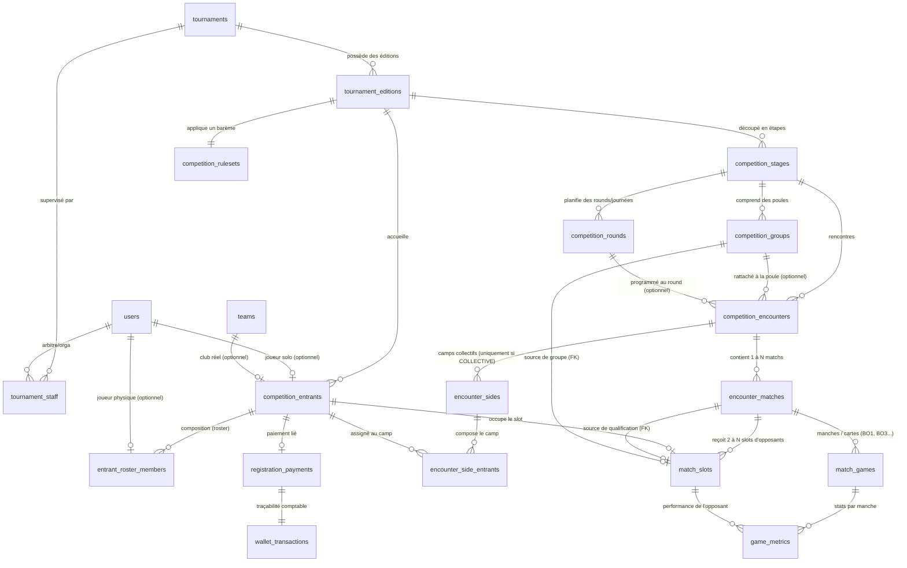

# Document 05 — Proposition d'Architecture Cible Universelle (Spécification Définitive)

Ce document constitue la référence formelle et définitive du modèle relationnel cible pour le système de compétition de Games Trafics. Il détaille l'ensemble des entités, leurs cardinalités, leurs contraintes d'intégrité et démontre concrètement le support des 6 formats compétitifs majeurs.

---

## 1. Vue d'Ensemble et Découplage Fondamental

Le modèle cible repose sur une séparation intransigeante des responsabilités :
1. **Identité Globale (`users`, `teams`, `team_members`) :** Les entités permanentes de la plateforme, strictement préservées lors de la purge.
2. **Encadrement (`tournament_staff`) :** Les arbitres et organisateurs, dissociés des compétiteurs.
3. **Entité Compétitive (`competition_entrants`, `entrant_roster_members`) :** L'unique entité inscrite à une édition, figée dans le temps, dissociée du club cosmétique sélectionné dans le jeu (`in_game_club`).
4. **Structure Temporelle et Sportive (`competition_stages`, `competition_groups`, `competition_rounds`) :** Distinction stricte entre poules de classement et journées de calendrier.
5. **Rencontres Universelles (`competition_encounters`, `encounter_sides`, `encounter_matches`, `match_slots`, `match_games`, `game_metrics`) :** Modèle relationnel polymorphe couvrant les duels, le FFA direct (sans côtés artificiels) et les confrontations collectives.
6. **Moteur Déclaratif (`competition_rulesets`) :** Paramétrage intégral en base des barèmes, calculs et départages sans développement TypeScript par jeu.

---

## 2. Diagramme Entité-Relation Cible Définitif (Mermaid ERD)

---

## 3. Dictionnaire des Données et Cardinalités Exactes

### A. Niveau Compétition et Inscriptions

#### 1. `tournaments`
* **Rôle :** Conteneur permanent de la compétition (ex. *Ligue des Champions Games Trafics*).
* **Colonnes clés :** `id` (UUID PK), `name` (unique), `game` (string), `platform` (enum), `organizer_id` (FK `users.id`).
* **Sort :** Structure conservée et épurée des champs obsolètes. Données historiques purgées.

#### 2. `tournament_editions`
* **Rôle :** Instance événementielle temporelle (ex. *Édition 2026 - Saison 1*).
* **Colonnes clés :** `id` (UUID PK), `tournament_id` (FK `tournaments.id` ON DELETE CASCADE), `edition_number` (int), `start_date` (timestamp), `end_date` (timestamp), `prize_pool` (numeric), `entry_fee` (numeric), `ruleset_id` (FK `competition_rulesets.id`), `ruleset_version` (int), `financial_account_id` (FK `financial_accounts.id`).
* **Cardinalité :** 1 tournoi -> 1 à N éditions.

#### 3. `tournament_staff`
* **Rôle :** Encadrement administratif et arbitrage de la compétition.
* **Colonnes clés :** `id` (UUID PK), `tournament_id` (FK `tournaments.id` ON DELETE CASCADE), `edition_id` (FK nullable `tournament_editions.id`), `user_id` (FK `users.id`), `role` (enum: `ORGANIZER`, `HEAD_REFEREE`, `REFEREE`, `CASTER`), `permissions` (text[]).
* **Contrainte d'unicité :** `UNIQUE(edition_id, user_id, role)`.

#### 4. `competition_entrants`
* **Rôle :** L'unique entité compétitrice admise dans l'édition.
* **Colonnes clés :** `id` (UUID PK), `edition_id` (FK `tournament_editions.id` ON DELETE CASCADE), `type` (enum: `SOLO`, `TEAM`, `GUEST`), `user_id` (FK nullable `users.id`), `team_id` (FK nullable `teams.id`), `name` (string), `tag` (string), `logo` (string), `seed` (int nullable), `in_game_club` (string nullable, ex: *"Real Madrid"*), `status` (enum: `REGISTERED`, `CHECKED_IN`, `DISQUALIFIED`), `custom_fields` (jsonb).
* **Contrainte :** `CHECK ((type = 'SOLO' AND user_id IS NOT NULL) OR (type = 'TEAM' AND team_id IS NOT NULL) OR (type = 'GUEST'))`.

#### 5. `entrant_roster_members`
* **Rôle :** Composition humaine figée de l'entrant pour cette édition spécifique.
* **Colonnes clés :** `id` (UUID PK), `entrant_id` (FK `competition_entrants.id` ON DELETE CASCADE), `user_id` (FK nullable `users.id`), `in_game_name` (string), `in_game_id` (string), `role` (enum: `CAPTAIN`, `STARTER`, `SUBSTITUTE`, `COACH`).
* **Cardinalité :** 1 entrant -> 1 à N membres de roster. (Pour un solo, N = 1).

---

### B. Niveau Structurel

#### 6. `competition_stages`
* **Rôle :** Grande étape logique (ex. *Phase de Poules*, *Playoffs Double Elimination*).
* **Colonnes clés :** `id` (UUID PK), `edition_id` (FK `tournament_editions.id` ON DELETE CASCADE), `name` (string), `stage_type` (enum: `ROUND_ROBIN`, `SINGLE_ELIMINATION`, `DOUBLE_ELIMINATION`, `SWISS`, `BATTLE_ROYALE_LADDER`), `order` (int).
* **Cardinalité :** 1 édition -> 1 à N stages.

#### 7. `competition_groups`
* **Rôle :** Poule de classement au sein d'une phase.
* **Colonnes clés :** `id` (UUID PK), `stage_id` (FK `competition_stages.id` ON DELETE CASCADE), `name` (string, ex: *"Poule A"*), `order` (int).
* **Cardinalité :** 1 stage -> 0 à N groups. (0 si élimination directe pure sans poules).

#### 8. `competition_rounds`
* **Rôle :** Unité temporelle de calendrier.
* **Colonnes clés :** `id` (UUID PK), `stage_id` (FK `competition_stages.id` ON DELETE CASCADE), `round_number` (int), `name` (string, ex: *"Journée 1"*, *"Quarts de Finale"*), `scheduled_date` (timestamp).
* **Cardinalité :** 1 stage -> 1 à N rounds.

---

### C. Niveau Rencontres, Matchs, Slots et Manches

#### 9. `competition_encounters`
* **Rôle :** Conteneur de confrontation globale (Duel, Choc Collectif ou Arène FFA).
* **Colonnes clés :** `id` (UUID PK), `stage_id` (FK `competition_stages.id` ON DELETE CASCADE), `group_id` (FK nullable `competition_groups.id`), `round_id` (FK nullable `competition_rounds.id`), `encounter_type` (enum: `DUEL`, `FFA`, `COLLECTIVE_FIXTURE`), `aggregation_rule` (enum: `DIRECT`, `MATCH_POINTS`, `SCORE_SUM`, `SERIES_WINS`), `status` (enum: `PENDING`, `READY`, `LIVE`, `COMPLETED`, `DISPUTED`), `scheduled_time` (timestamp).

#### 10. `encounter_sides` (Utilisé UNIQUEMENT si `encounter_type = 'COLLECTIVE_FIXTURE'`)
* **Rôle :** Représente les deux camps d'une confrontation collective (ex: Camp 1 = Dakar, Camp 2 = Thiès).
* **Colonnes clés :** `id` (UUID PK), `encounter_id` (FK `competition_encounters.id` ON DELETE CASCADE), `side_number` (int: 1 ou 2), `name` (string), `final_aggregated_points` (numeric(12,4)), `result` (enum: `WIN`, `LOSS`, `DRAW`).
* **Cardinalité :** 1 encounter collectif -> exactement 2 sides.

#### 11. `encounter_side_entrants`
* **Rôle :** Liste des participants composant chaque camp collectif.
* **Colonnes clés :** `id` (UUID PK), `side_id` (FK `encounter_sides.id` ON DELETE CASCADE), `entrant_id` (FK `competition_entrants.id` ON DELETE CASCADE).

#### 12. `encounter_matches`
* **Rôle :** Le match physique ou le sous-match disputé entre opposants.
  * Dans un duel 1v1 ou TvT : l'encounter contient **exactement 1** `encounter_match`.
  * Dans un FFA : l'encounter contient **exactement 1** `encounter_match` (qui réunit N slots).
  * Dans une confrontation collective : l'encounter contient **N** `encounter_matches` (les sous-matchs : Match 1, Match 2, etc.).
* **Colonnes clés :** `id` (UUID PK), `encounter_id` (FK `competition_encounters.id` ON DELETE CASCADE), `match_order` (int), `title` (string, ex: *"Simple 1"*, *"Lobby Principal"*), `match_format` (enum: `BEST_OF_1`, `BEST_OF_3`, `BEST_OF_5`, `TWO_LEGS_AGGREGATE`, `POINTS_SERIES`), `points_weight` (numeric(12,4) default 1.0), `status` (enum: `PENDING`, `COMPLETED`).

#### 13. `match_slots`
* **Rôle :** Emplacement d'adversaire au sein d'un match.
* **Colonnes clés :**
  * `id` (UUID PK).
  * `match_id` (FK `encounter_matches.id` ON DELETE CASCADE).
  * `slot_position` (int : 1, 2 dans un duel ; 1 à N dans un FFA).
  * `assigned_entrant_id` (FK nullable `competition_entrants.id`).
  * `source_type` (enum: `DIRECT_SEED`, `MATCH_WINNER`, `MATCH_LOSER`, `GROUP_RANK`, `CROSS_GROUP_RANK`, `BYE`, `MANUAL_OVERRIDE`).
  * `source_match_id` (FK nullable `encounter_matches.id`).
  * `source_group_id` (FK nullable `competition_groups.id`).
  * `source_rank` (int nullable).
  * `is_locked` (boolean default false) : **Protège le slot contre tout recalcul automatique.**
  * `final_match_score` (numeric(12,4)) : Score final ou manches gagnées.
  * `final_match_rank` (int nullable) : Rang final dans le match.
  * `is_winner` (boolean default false).
* **Contrainte d'unicité :** `UNIQUE(match_id, slot_position)`.

#### 14. `match_games`
* **Rôle :** Manche ou carte individuelle au sein d'un match (Carte 1, Carte 2...).
* **Colonnes clés :** `id` (UUID PK), `match_id` (FK `encounter_matches.id` ON DELETE CASCADE), `game_number` (int), `map_name` (string nullable), `status` (enum: `PENDING`, `COMPLETED`), `proof_url` (string nullable).
* **Cardinalité :** 1 match -> 1 à X games.

#### 15. `game_metrics`
* **Rôle :** Statistiques brutes et points calculés pour chaque slot dans chaque manche.
* **Colonnes clés :** `id` (UUID PK), `game_id` (FK `match_games.id` ON DELETE CASCADE), `slot_id` (FK `match_slots.id` ON DELETE CASCADE), `score` (int default 0), `kills` (int default 0), `placement` (int nullable), `survival_time_ms` (bigint nullable), `laps_time_ms` (bigint nullable), `penalties` (numeric(12,4) default 0), `points_awarded` (numeric(12,4) default 0).
* **Contrainte d'unicité :** `UNIQUE(game_id, slot_id)`.

---

## 4. Démonstration Concrète des Six Formats Compétitifs

### Format 1 : Duel Individuel 1v1 (eFootball / EA Sports FC)
* **Configuration :** 1 `competition_encounter` (`encounter_type = 'DUEL'`, `aggregation_rule = 'DIRECT'`).
* **Matches :** Exactement 1 `encounter_match` (`match_format = 'BEST_OF_1'`).
* **Sides :** Aucun `encounter_sides` créé (inutile en duel simple).
* **Slots :** 2 `match_slots` :
  * Slot 1 : `assigned_entrant_id = Joueur A`, `slot_position = 1`.
  * Slot 2 : `assigned_entrant_id = Joueur B`, `slot_position = 2`.
* **Game :** 1 `match_game` (Game 1).
* **Métriques :** Slot 1 : `score = 3` ; Slot 2 : `score = 1`.
* **Résolution :** Slot 1 `is_winner = true`.

### Format 2 : Duel par Équipes (Team vs Team 5v5 — Valorant / League of Legends)
* **Configuration :** 1 `competition_encounter` (`encounter_type = 'DUEL'`).
* **Entrants :** Entrant A (Team Vitality), Entrant B (Karmine Corp).
* **Rosters :** 5 joueurs titulaires liés à Entrant A dans `entrant_roster_members`, 5 à Entrant B.
* **Slots :** 2 `match_slots` occupés par Entrant A et Entrant B.
* **Résolution :** Victoire attribuée à l'entité équipe.

### Format 3 : Série en Manches Multiples BO3 / BO5 (COD Mobile Search & Destroy)
* **Configuration :** 1 `encounter_match` (`match_format = 'BEST_OF_3'`).
* **Manches :** 3 `match_games` pré-créées :
  * Game 1 (Map: Standoff) : Slot 1 gagne 6-4.
  * Game 2 (Map: Raid) : Slot 2 gagne 6-3.
  * Game 3 (Map: Firing Range) : Slot 1 gagne 6-5.
* **Résolution :** Le Rule Engine compte 2 manches gagnées pour le Slot 1 -> Slot 1 déclaré vainqueur 2-1 de la série.

### Format 4 : FFA Direct sans Côtés Artificiels (Course Asphalt 9 à 8 Pilotes)
* **Démonstration de non-nécessité des Sides :**
  * `competition_encounters.encounter_type = 'FFA'`.
  * Aucun enregistrement dans `encounter_sides`.
  * 1 `encounter_match` (`match_format = 'POINTS_SERIES'`).
  * **8 `match_slots` directs** (`slot_position` de 1 à 8), chacun assigné à un pilote indépendant.
  * Pour chaque course (`match_games`), 8 enregistrements dans `game_metrics` contenant le `placement` (1 à 8) et le `laps_time_ms`.
  * Les points sont calculés et cumulés par slot sans aucune structure artificielle à deux camps.

### Format 5 : Battle Royale Multi-Manches (Free Fire — 12 Escouades)
* **Configuration :** `competition_encounters.encounter_type = 'FFA'`.
* **Slots :** 12 `match_slots` directs (un par escouade).
* **Manches :** 4 `match_games` (Manche 1: Bermuda, Manche 2: Purgatory, Manche 3: Kalahari, Manche 4: Bermuda).
* **Calcul par Manche dans `game_metrics` :**
  * Escouade 1 : `placement = 1` (12 pts) + `kills = 8` (8 pts) = 20 pts.
  * Escouade 2 : `placement = 2` (9 pts) + `kills = 14` (14 pts) = 23 pts.
* **Résultat Général de l'Encounter :** Somme arithmétique des `points_awarded` sur les 4 manches. Classement final généré instantanément.

### Format 6 : Confrontation Collective Inter-Régions (Région Dakar vs Région Thiès)
* **Configuration Parent :**
  * `competition_encounters.encounter_type = 'COLLECTIVE_FIXTURE'`.
  * `aggregation_rule = 'MATCH_POINTS'`.
* **Les Deux Camps (`encounter_sides`) :**
  * Side 1 : `name = "Région Dakar"` (5 entrants liés via `encounter_side_entrants`).
  * Side 2 : `name = "Région Thiès"` (5 entrants liés via `encounter_side_entrants`).
* **Les Sous-Matchs (`encounter_matches`) :**
  * Match 1 : `title = "Simple 1"`, Slot 1 (Dakar 1) vs Slot 2 (Thiès 1) -> Victoire Dakar (1 pt).
  * Match 2 : `title = "Simple 2"`, Slot 1 (Dakar 2) vs Slot 2 (Thiès 2) -> Victoire Thiès (1 pt).
  * Match 3 : `title = "Simple 3"`, Slot 1 (Dakar 3) vs Slot 2 (Thiès 3) -> Victoire Dakar (1 pt).
  * Match 4 : `title = "Double"`, Slot 1 (Dakar 4) vs Slot 2 (Thiès 4) -> Victoire Thiès (1 pt).
  * Match 5 : `title = "Match Décisif"`, Slot 1 (Dakar 5) vs Slot 2 (Thiès 5) -> Victoire Dakar (1 pt).
* **Agrégation :** Side 1 totalise 3 points, Side 2 totalise 2 points -> Side 1 déclaré vainqueur de la confrontation 3 à 2.
