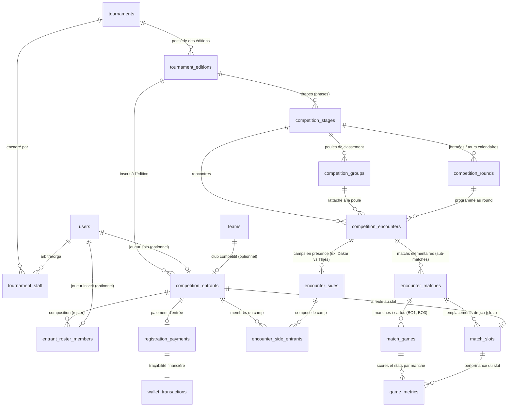

# Document 05 — Proposition d'Architecture Cible Universelle (Version Approfondie)

Ce document présente l'architecture cible complète, corrigée et enrichie, répondant à l'ensemble des exigences de modularité, de flexibilité et de rigueur exprimées par l'équipe de Games Trafics.

---

## 1. Principes Directeurs et Séparation des Responsabilités

```text
┌─────────────────────────────────────────────────────────────────────────────┐
│                    LES 5 PILIERS DE L'ARCHITECTURE CIBLE                    │
├─────────────────────────────────────────────────────────────────────────────┤
│ 1. DISSOCIATION STAFF / SPORT / IDENTITÉ / ASSET DE JEU                     │
│    • Staff (arbitres, organisateurs) != Entrants (compétiteurs).            │
│    • Entité compétitive (Entrant) != Roster physique (Membres).             │
│    • Équipe réelle (FC Douane) != Club cosmétique de jeu (Real Madrid).     │
├─────────────────────────────────────────────────────────────────────────────┤
│ 2. MODÉLISATION RELATIONNELLE DES CONFRONTATIONS COLLECTIVES                │
│    • Support natif des chocs "Région A vs Région B" ou "Guerres de Clans".   │
│    • Rencontre parent à 2 camps (Sides) contenant N sous-matchs individuels.│
│    • Règles d'agrégation configurables (points de match, score cumulé).     │
├─────────────────────────────────────────────────────────────────────────────┤
│ 3. SLOTS DE BRACKET RELATIONNELS ET PROGRESSION DAG                         │
│    • Pas de JSON opaque pour les sources : clés étrangères relationnelles.  │
│    • Support complet de la Double Élimination et du Bracket Reset.          │
│    • Gestion des BYE, des reports et validation d'acyclicité (anti-boucles).│
├─────────────────────────────────────────────────────────────────────────────┤
│ 4. MOTEUR DE RÈGLES DÉCLARATIF SANS CODE SPÉCIFIQUE (RULE ENGINE)           │
│    • Les organisateurs configurent leurs barèmes, métriques et départages   │
│      directement en base de données sans intervention de développeur.       │
├─────────────────────────────────────────────────────────────────────────────┤
│ 5. HIERARCHIE STRUCTURELLE INTRANSIGEANTE                                   │
│    • Phase (Étape logique) ──> Groupe (Poule de classement).                │
│    • Round (Journée / Calendrier temporel, indépendant des poules).         │
│    • Rencontre (Duel, Confrontation Collective ou Lobby FFA).               │
└─────────────────────────────────────────────────────────────────────────────┘
```

---

## 2. Modèle Relationnel Cible Complet (Diagramme Mermaid)



---

## 3. Spécification Détaillée des Entités et Responsabilités

### A. Participants, Rosters, Staff et Clubs en Jeu

#### 1. `tournament_staff` (Encadrement et Rôles)
Isole définitivement le staff de l'organisation sportive :
* `id` : UUID.
* `tournament_id` : UUID (FK vers `tournaments`).
* `edition_id` : UUID (Optionnel, null si staff permanent du tournoi).
* `user_id` : UUID (FK vers `users`).
* `role` : Enum (`ORGANIZER`, `CO_ORGANIZER`, `HEAD_REFEREE`, `REFEREE`, `CASTER`, `OBSERVER`).
* `permissions` : JSONB (`["VALIDATE_SCORES", "EDIT_SCHEDULE", "RESOLVE_DISPUTE"]`).

#### 2. `competition_entrants` (L'Entité Compétitive Unique)
Représente l'unique entité admise à concourir dans une édition :
* `id` : UUID.
* `edition_id` : UUID (FK vers `tournament_editions`).
* `type` : Enum (`SOLO`, `TEAM`, `GUEST`).
* `user_id` : UUID (Nullable, FK vers `users`, si joueur solo).
* `team_id` : UUID (Nullable, FK vers `teams`, si équipe globale officielle).
* `name` : String (Nom d'affichage pour la compétition, ex. *"FC Douane"* ou *"Abidjan Esport"*).
* `tag` : String (ex. *"FCD"*, *"ABJ"*).
* `logo` : String (URL).
* `seed` : Integer (Tête de série initiale).
* `in_game_club` : String (Nullable, ex. *"Real Madrid"* ou *"Manchester City"* — le club de football choisi dans le jeu, **strictement dissocié** de l'équipe compétitive réelle `team_id`).
* `status` : Enum (`PENDING`, `REGISTERED`, `CONFIRMED`, `CHECKED_IN`, `DISQUALIFIED`, `WITHDRAWN`).
* `custom_fields` : JSONB (Riot ID, In-game UID, Téléphone, etc.).
* `registration_payment_id` : UUID (Nullable, FK vers `registration_payments`).

#### 3. `entrant_roster_members` (Composition Figée de l'Édition)
* `id` : UUID.
* `entrant_id` : UUID (FK vers `competition_entrants`, cascade).
* `user_id` : UUID (Nullable, pour les invités n'ayant pas de compte).
* `in_game_name` : String (Pseudo du joueur en jeu).
* `in_game_id` : String (Identifiant en jeu du joueur).
* `role` : Enum (`CAPTAIN`, `STARTER`, `SUBSTITUTE`, `COACH`).
* `photo_url` : String (Nullable).

---

### B. Confrontations Collectives (Inter-Régions, Clan Wars, Équipes vs Équipes)

Pour modéliser une confrontation opposant la **Région Dakar** à la **Région Thiès**, où 5 sous-matchs ont lieu entre les joueurs des deux camps, le modèle utilise une relation hiérarchique parent/enfant :

#### 1. `competition_encounters` (Rencontre Parent)
* `id` : UUID.
* `stage_id` : UUID.
* `group_id` : UUID (Optionnel).
* `round_id` : UUID (Optionnel).
* `encounter_type` : Enum (`DUEL`, `COLLECTIVE_FIXTURE`, `FFA_LOBBY`).
* `aggregation_rule` : Enum (`MATCH_POINTS`, `SCORE_SUM`, `SERIES_WINS`, `TIED_POINTS_WITH_DECIDER`).
  * `MATCH_POINTS` : Chaque sous-match rapporte des points (ex. 1 pt par victoire). Le camp qui a le plus de points gagne la rencontre.
  * `SCORE_SUM` : Somme arithmétique des scores de tous les sous-matchs (ex. total des buts marqués).
* `status` : Enum (`PENDING`, `SCHEDULED`, `LIVE`, `COMPLETED`, `DISPUTED`).
* `winner_side_id` : UUID (Nullable, FK vers `encounter_sides`).

#### 2. `encounter_sides` (Les Camps en Présence)
* `id` : UUID.
* `encounter_id` : UUID (FK vers `competition_encounters`).
* `side_number` : Integer (1 = Côté Domicile / Camp A, 2 = Côté Extérieur / Camp B).
* `name` : String (ex. *"Région Dakar"*, *"Clan Alpha"*).
* `final_aggregated_score` : Numeric (Score global obtenu par le camp).
* `result` : Enum (`WIN`, `LOSS`, `DRAW`).

#### 3. `encounter_side_entrants` (Participants affectés à chaque camp)
* `id` : UUID.
* `side_id` : UUID (FK vers `encounter_sides`).
* `entrant_id` : UUID (FK vers `competition_entrants`).
* `role_in_side` : String (ex. *"Joueur 1"*, *"Capitaine"*, *"Duo A"*).

#### 4. `encounter_matches` (Les Sous-Matchs Individuels Enfants)
* `id` : UUID.
* `encounter_id` : UUID (FK vers `competition_encounters`).
* `match_order` : Integer (Match 1, Match 2, Match 3...).
* `title` : String (ex. *"Simple 1 (Dakar 1 vs Thiès 1)"*, *"Double Décisif"*).
* `format` : Enum (`BEST_OF_1`, `BEST_OF_3`, `TWO_LEGS`).
* `status` : Enum (`PENDING`, `COMPLETED`).
* `points_value` : Numeric (Valeur du match dans l'agrégation, ex. 1 point ou 3 points pour le match des as).

---

### C. Slots de Bracket et Dépendances de Progression Relationnelles

Pour bannir tout bricolage en JSON et fiabiliser la progression dans les arbres (Single Elimination, Double Elimination, Grand Finals et Bracket Reset) :

#### `match_slots` (Emplacements Relationnels d'un Match)
* `id` : UUID.
* `match_id` : UUID (FK vers `encounter_matches`).
* `slot_position` : Integer (1 = Haut/Bleu, 2 = Bas/Rouge).
* `assigned_entrant_id` : UUID (Nullable, FK vers `competition_entrants`).
* **Source de Qualification Relationnelle (Colonnes strictes) :**
  * `source_type` : Enum (`DIRECT_SEED`, `MATCH_WINNER`, `MATCH_LOSER`, `GROUP_RANK`, `CROSS_GROUP_RANK`, `BYE`, `MANUAL_OVERRIDE`).
  * `source_match_id` : UUID (Nullable, FK vers `encounter_matches` pour `MATCH_WINNER` ou `MATCH_LOSER`).
  * `source_group_id` : UUID (Nullable, FK vers `competition_groups` pour `GROUP_RANK`).
  * `source_rank` : Integer (Nullable, ex. `1` pour le premier de poule, `2` pour le second).
* `is_locked` : Boolean (Permet à un arbitre de figer un slot sans que l'algorithme ne l'écrase).
* `score` : Integer (Score final de ce slot dans le match).
* `is_winner` : Boolean.

#### Gestion Avancée du Double Elimination et Bracket Reset
* **Upper Bracket (Winner) :** Les vainqueurs progressent vers le tour supérieur de l'Upper Bracket (`source_type: MATCH_WINNER`).
* **Lower Bracket (Loser) :** Les perdants de l'Upper descendent vers le tour correspondant du Lower Bracket (`source_type: MATCH_LOSER`).
* **Grand Finals :** Slot 1 = Vainqueur Upper Bracket (`MATCH_WINNER`), Slot 2 = Vainqueur Lower Bracket (`MATCH_WINNER`).
* **Bracket Reset Automatique :** Si le Slot 2 (venant du Lower Bracket) bat le Slot 1, un match additionnel pré-créé avec `is_conditional = true` s'active automatiquement pour déterminer le champion final.

---

### D. Moteur de Règles Configurable en Base (Universal Rule Engine)

Plutôt que d'écrire une classe TypeScript pour chaque jeu, la configuration est entièrement stockée sous forme déclarative dans la table `competition_rulesets` :

#### `competition_rulesets`
* `id` : UUID.
* `name` : String (ex. *"FIFA Standard 3-1-0"*, *"PUBG Mobile Esports Official"*, *"COD Mobile BO3"*).
* `scoring_mode` : Enum (`POINTS_TABLE`, `METRIC_ACCUMULATION`, `SERIES_WINS`).
* **Barème de base :**
  * `points_for_win` : Numeric (ex. 3).
  * `points_for_draw` : Numeric (ex. 1).
  * `points_for_loss` : Numeric (ex. 0).
* **Matrice de placement (Pour Battle Royale / Racing) :**
  * `placement_points` : JSONB (ex. `{"1": 12, "2": 9, "3": 8, "4": 7, "5": 6, "6": 5, "7": 4, "8": 3, "9": 2, "10": 1}`).
* **Multiplicateurs de métriques brutes :**
  * `metric_multipliers` : JSONB (ex. `{"kills": 1, "lap_bonus": 2}`).
* **Chaîne ordonnée de critères de départage (`tiebreaker_chain`) :**
  * Liste ordonnée de critères évalués successivement :
    `["POINTS", "HEAD_TO_HEAD", "GOAL_DIFF", "WINS_COUNT", "GOALS_FOR", "LAST_GAME_PLACEMENT"]`.
* **Règles de qualification :**
  * `advance_count` : Nombre de qualifiés par groupe.
  * `cross_group_best_count` : Nombre de "meilleurs troisièmes" qualifiés transversalement.

Un **Universal Rule Evaluator** unique en TypeScript applique cette configuration de façon déterministe. L'organisateur ajuste ses curseurs depuis son interface sans qu'aucune ligne de code ne soit déployée.

---

## 4. Exemples Concrets d'Instanciation

### Exemple 1 : Duel 1v1 eFootball avec Club Cosmétique
* **Entrant :** Joueur solo Amadou (`user_id: usr_123`, `name: "Amadou99"`, `in_game_club: "FC Barcelone"`).
* **Match :** 1 match, 2 `match_slots`. Score final : 3 - 1.
* **Scoring :** Barème Sports standard (3 pts pour Amadou).

### Exemple 2 : Match par Équipes COD Mobile 5v5 en Best-of-3
* **Entrants :** Deux clubs compétitifs : FC Douane (`team_id: tm_1`) vs Dakar E-Club (`team_id: tm_2`).
* **Rosters :** 5 titulaires + 1 remplaçant figés dans `entrant_roster_members`.
* **Match :** 1 confrontation, 3 `match_games` (Carte 1: Hardpoint, Carte 2: SnD, Carte 3: Control).
* **Score :** Résolu en `SERIES_WINS` (FC Douane gagne 2 à 1).

### Exemple 3 : Manche de Battle Royale Free Fire (12 Escouades)
* **Entrants :** 12 escouades de 4 joueurs.
* **Encounter :** 1 confrontation FFA regroupant les 12 escouades.
* **Résultat Manche 1 :**
  * Escouade A : Top 1 (12 pts) + 8 kills (8 pts) = 20 pts.
  * Escouade B : Top 2 (9 pts) + 12 kills (12 pts) = 21 pts (Leader au score malgré le Top 2).
* Le Rule Engine calcule automatiquement les totaux sans code spécifique.

### Exemple 4 : Confrontation Collective Inter-Régions (Dakar vs Thiès)
* **Encounter :** `COLLECTIVE_FIXTURE`, `aggregation_rule: MATCH_POINTS`.
* **Side 1 :** Région Dakar (composée de 5 entrants).
* **Side 2 :** Région Thiès (composée de 5 entrants).
* **5 Matchs individuels :**
  * Match 1 : Dakar 1 bat Thiès 1 (Dakar : 1 pt)
  * Match 2 : Thiès 2 bat Dakar 2 (Thiès : 1 pt)
  * Match 3 : Dakar 3 bat Thiès 3 (Dakar : 1 pt)
  * Match 4 : Thiès 4 bat Dakar 4 (Thiès : 1 pt)
  * Match 5 : Dakar 5 bat Thiès 5 (Dakar : 1 pt)
* **Score global agrégé :** Région Dakar remporte la confrontation 3 à 2.
