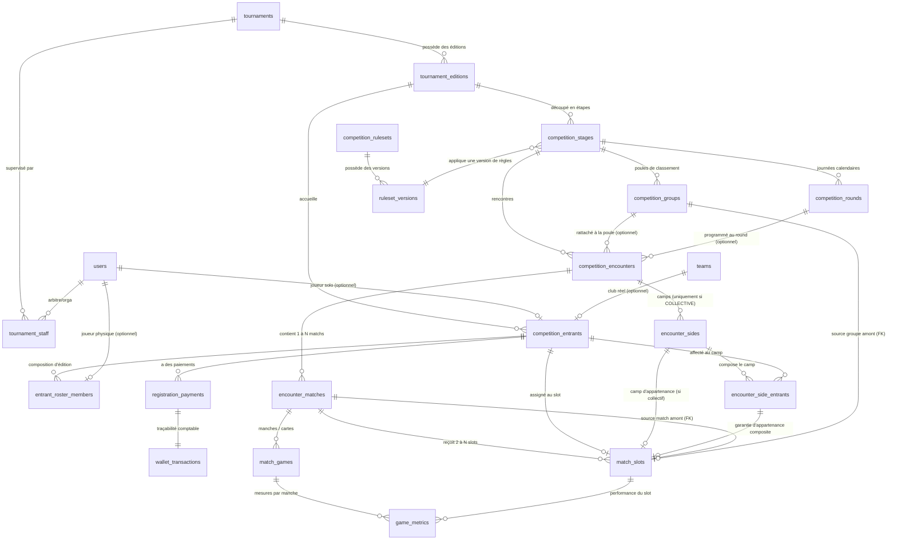

# Document 05 — Proposition d'Architecture Cible Universelle (Spécification Définitive et Complète)

Ce document constitue la référence formelle, exhaustive et validée de l'architecture cible du système de compétition de Games Trafics. Il définit l'ensemble des tables, colonnes, cardinalités, contraintes SQL, relations d'intégrité et démontre concrètement la prise en charge de l'ensemble des formats compétitifs.

---

## 1. Principes Directeurs et Séparation des Responsabilités

Le modèle relationnel garantit 6 séparations strictes :
1. **Identité Globale (`users`, `teams`, `team_members`) :** Entités permanentes de la plateforme, intangibles et préservées lors de toute opération sur les tournois.
2. **Encadrement Administratif (`tournament_staff`) :** Arbitres, organisateurs et casters, formellement dissociés des compétiteurs.
3. **Entité Compétitive Unique (`competition_entrants`, `entrant_roster_members`) :** L'unique unité en compétition (Solo, Équipe, Invité), figée pour une édition donnée, indépendante du club cosmétique sélectionné dans le jeu (`in_game_club`).
4. **Structure Temporelle et Sportive (`competition_stages`, `competition_groups`, `competition_rounds`) :** Découplage strict entre poules de classement et calendrier des journées.
5. **Rencontres Polymorphes et Sécurisées (`competition_encounters`, `encounter_sides`, `encounter_side_entrants`, `encounter_matches`, `match_slots`, `match_games`, `game_metrics`) :**
   * **Duels standards (1v1, TvT) :** 1 encounter $\rightarrow$ 1 match $\rightarrow$ 2 slots directs. Aucun camp (`encounter_sides`) superflu.
   * **FFA direct (Courses, Battle Royale) :** 1 encounter $\rightarrow$ 1 match $\rightarrow$ N slots directs. **Zéro côté artificiel.**
   * **Confrontations Collectives (Inter-Régions, Clan Wars) :** 1 encounter parent $\rightarrow$ 2 camps (`encounter_sides`) $\rightarrow$ N sous-matchs dont chaque slot est contraint par clé étrangère composite à appartenir à son camp.
6. **Moteur Déclaratif Piloté par les Données (`competition_rulesets`, `ruleset_versions`) :** Règles de scoring, métriques, départages et qualifications configurables en base par phase sans développement de code.

---

## 2. Diagramme Entité-Relation Cible Définitif (Mermaid ERD)



---

## 3. Spécification Détaillée des Tables et Contraintes SQL

### A. Niveau Compétition et Inscriptions

#### 1. `tournaments`
* `id` : `UUID PRIMARY KEY DEFAULT gen_random_uuid()`
* `name` : `TEXT NOT NULL UNIQUE`
* `slug` : `TEXT UNIQUE`
* `game` : `TEXT NOT NULL`
* `platform` : `TEXT NOT NULL DEFAULT 'MOBILE'`
* `organizer_id` : `TEXT NOT NULL REFERENCES users(id)`
* `description` : `TEXT`
* `logo` : `TEXT`
* `banner` : `TEXT`
* `is_active` : `BOOLEAN DEFAULT TRUE`
* `created_at` : `TIMESTAMP DEFAULT NOW()`
* `updated_at` : `TIMESTAMP DEFAULT NOW()`

#### 2. `tournament_editions`
* `id` : `UUID PRIMARY KEY DEFAULT gen_random_uuid()`
* `tournament_id` : `UUID NOT NULL REFERENCES tournaments(id) ON DELETE CASCADE`
* `edition_number` : `INTEGER NOT NULL`
* `name` : `TEXT NOT NULL`
* `start_date` : `TIMESTAMP NOT NULL`
* `end_date` : `TIMESTAMP`
* `registration_opens` : `TIMESTAMP`
* `registration_deadline` : `TIMESTAMP`
* `max_entrants` : `INTEGER`
* `entry_fee` : `NUMERIC(15, 2) DEFAULT '0'`
* `prize_pool` : `NUMERIC(15, 2) DEFAULT '0'`
* `prize_currency` : `TEXT DEFAULT 'GTC'`
* `financial_account_id` : `TEXT REFERENCES financial_accounts(id)`
* `default_ruleset_version_id` : `UUID REFERENCES ruleset_versions(id)`
* `status` : `TEXT NOT NULL DEFAULT 'UPCOMING'` (UPCOMING, REGISTRATION, LIVE, COMPLETED, CANCELLED)
* `created_at` : `TIMESTAMP DEFAULT NOW()`
* `updated_at` : `TIMESTAMP DEFAULT NOW()`
* **Contrainte d'unicité :** `UNIQUE(tournament_id, edition_number)`

#### 3. `tournament_staff`
* `id` : `UUID PRIMARY KEY DEFAULT gen_random_uuid()`
* `tournament_id` : `UUID NOT NULL REFERENCES tournaments(id) ON DELETE CASCADE`
* `edition_id` : `UUID REFERENCES tournament_editions(id) ON DELETE CASCADE` (NULL si permanent)
* `user_id` : `TEXT NOT NULL REFERENCES users(id) ON DELETE CASCADE`
* `role` : `TEXT NOT NULL` (ORGANIZER, CO_ORGANIZER, HEAD_REFEREE, REFEREE, CASTER, OBSERVER)
* `permissions` : `TEXT[] DEFAULT '{}'`
* `created_at` : `TIMESTAMP DEFAULT NOW()`
* **Contrainte d'unicité :** `UNIQUE(tournament_id, edition_id, user_id, role)`

#### 4. `competition_entrants`
* `id` : `UUID PRIMARY KEY DEFAULT gen_random_uuid()`
* `edition_id` : `UUID NOT NULL REFERENCES tournament_editions(id) ON DELETE CASCADE`
* `type` : `TEXT NOT NULL` (SOLO, TEAM, GUEST)
* `user_id` : `TEXT REFERENCES users(id) ON DELETE RESTRICT`
* `team_id` : `TEXT REFERENCES teams(id) ON DELETE RESTRICT`
* `name` : `TEXT NOT NULL`
* `tag` : `TEXT`
* `logo` : `TEXT`
* `seed` : `INTEGER`
* `in_game_club` : `TEXT` (ex. "Real Madrid", "Barcelone" — choix cosmétique en jeu)
* `status` : `TEXT NOT NULL DEFAULT 'REGISTERED'` (REGISTERED, CHECKED_IN, DISQUALIFIED, WITHDRAWN)
* `custom_fields` : `JSONB DEFAULT '{}'`
* `final_rank` : `INTEGER`
* `created_at` : `TIMESTAMP DEFAULT NOW()`
* `updated_at` : `TIMESTAMP DEFAULT NOW()`
* **Contraintes SQL :**
  ```sql
  CHECK (
    (type = 'SOLO' AND user_id IS NOT NULL AND team_id IS NULL) OR
    (type = 'TEAM' AND team_id IS NOT NULL AND user_id IS NULL) OR
    (type = 'GUEST' AND team_id IS NULL)
  );
  -- Unicité SOLO : un utilisateur ne peut s'inscrire qu'une fois en solo par édition
  CREATE UNIQUE INDEX entrants_edition_user_unique ON competition_entrants(edition_id, user_id) WHERE type = 'SOLO';
  -- Unicité TEAM : une équipe ne peut s'inscrire qu'une fois par édition
  CREATE UNIQUE INDEX entrants_edition_team_unique ON competition_entrants(edition_id, team_id) WHERE type = 'TEAM';
  ```

#### 5. `entrant_roster_members`
* `id` : `UUID PRIMARY KEY DEFAULT gen_random_uuid()`
* `edition_id` : `UUID NOT NULL REFERENCES tournament_editions(id) ON DELETE CASCADE`
* `entrant_id` : `UUID NOT NULL REFERENCES competition_entrants(id) ON DELETE CASCADE`
* `user_id` : `TEXT REFERENCES users(id) ON DELETE RESTRICT` (Optionnel pour invités)
* `in_game_name` : `TEXT NOT NULL`
* `in_game_id` : `TEXT`
* `role` : `TEXT NOT NULL DEFAULT 'STARTER'` (CAPTAIN, STARTER, SUBSTITUTE, COACH)
* `is_active` : `BOOLEAN DEFAULT TRUE`
* `created_at` : `TIMESTAMP DEFAULT NOW()`
* **Contraintes SQL :**
  ```sql
  -- Unicité de rôle de capitaine par entrant
  CREATE UNIQUE INDEX entrant_captain_unique ON entrant_roster_members(entrant_id) WHERE role = 'CAPTAIN';
  -- Règle anti-cumul : un même utilisateur ne peut être joueur actif dans deux équipes de la même édition
  CREATE UNIQUE INDEX roster_edition_user_unique ON entrant_roster_members(edition_id, user_id) 
    WHERE user_id IS NOT NULL AND role IN ('CAPTAIN', 'STARTER', 'SUBSTITUTE');
  ```

#### 6. `registration_payments`
* `id` : `UUID PRIMARY KEY DEFAULT gen_random_uuid()`
* `entrant_id` : `UUID REFERENCES competition_entrants(id) ON DELETE SET NULL`
* `transaction_id` : `TEXT NOT NULL REFERENCES wallet_transactions(id) ON DELETE RESTRICT`
* `amount` : `NUMERIC(15, 2) NOT NULL`
* `currency` : `TEXT DEFAULT 'GTC'`
* `payment_method` : `TEXT DEFAULT 'WALLET'`
* `status` : `TEXT DEFAULT 'COMPLETED'` (PENDING, COMPLETED, REFUNDED, FAILED)
* `archived_edition_name` : `TEXT`
* `legacy_registration_id` : `TEXT`
* `created_at` : `TIMESTAMP DEFAULT NOW()`
* **Index :** `INDEX(entrant_id)`, `INDEX(transaction_id)`

---

### B. Niveau Structurel et Règles

#### 7. `competition_rulesets` & `ruleset_versions`
* `competition_rulesets` :
  * `id` : `UUID PRIMARY KEY DEFAULT gen_random_uuid()`
  * `name` : `TEXT NOT NULL UNIQUE`
  * `game` : `TEXT NOT NULL`
  * `created_at` : `TIMESTAMP DEFAULT NOW()`
* `ruleset_versions` :
  * `id` : `UUID PRIMARY KEY DEFAULT gen_random_uuid()`
  * `ruleset_id` : `UUID NOT NULL REFERENCES competition_rulesets(id) ON DELETE CASCADE`
  * `version` : `INTEGER NOT NULL`
  * `scoring_mode` : `TEXT NOT NULL` (POINTS_TABLE, METRIC_ACCUMULATION, SERIES_WINS)
  * `config` : `JSONB NOT NULL` (barèmes, matrices, tiebreaker_chain, qualification)
  * `is_published` : `BOOLEAN DEFAULT FALSE`
  * `created_at` : `TIMESTAMP DEFAULT NOW()`
  * **Contrainte d'unicité :** `UNIQUE(ruleset_id, version)`

#### 8. `competition_stages`
* `id` : `UUID PRIMARY KEY DEFAULT gen_random_uuid()`
* `edition_id` : `UUID NOT NULL REFERENCES tournament_editions(id) ON DELETE CASCADE`
* `ruleset_version_id` : `UUID NOT NULL REFERENCES ruleset_versions(id)`
* `name` : `TEXT NOT NULL`
* `stage_type` : `TEXT NOT NULL` (ROUND_ROBIN, SINGLE_ELIMINATION, DOUBLE_ELIMINATION, SWISS, BATTLE_ROYALE_LADDER, LEADERBOARD, TIME_TRIAL)
* `order` : `INTEGER NOT NULL`
* `status` : `TEXT NOT NULL DEFAULT 'PENDING'` (PENDING, ACTIVE, COMPLETED)
* `created_at` : `TIMESTAMP DEFAULT NOW()`
* **Contrainte d'unicité :** `UNIQUE(edition_id, order)`

#### 9. `competition_groups`
* `id` : `UUID PRIMARY KEY DEFAULT gen_random_uuid()`
* `stage_id` : `UUID NOT NULL REFERENCES competition_stages(id) ON DELETE CASCADE`
* `name` : `TEXT NOT NULL` (ex. "Poule A", "Poule B")
* `order` : `INTEGER NOT NULL`
* `created_at` : `TIMESTAMP DEFAULT NOW()`
* **Contrainte d'unicité :** `UNIQUE(stage_id, order)`

#### 10. `competition_rounds`
* `id` : `UUID PRIMARY KEY DEFAULT gen_random_uuid()`
* `stage_id` : `UUID NOT NULL REFERENCES competition_stages(id) ON DELETE CASCADE`
* `round_number` : `INTEGER NOT NULL`
* `name` : `TEXT NOT NULL` (ex. "Journée 1", "Quarts de finale")
* `scheduled_date` : `TIMESTAMP`
* `created_at` : `TIMESTAMP DEFAULT NOW()`
* **Contrainte d'unicité :** `UNIQUE(stage_id, round_number)`

---

### C. Niveau Rencontres, Matchs, Slots et Manches

#### 11. `competition_encounters`
* `id` : `UUID PRIMARY KEY DEFAULT gen_random_uuid()`
* `stage_id` : `UUID NOT NULL REFERENCES competition_stages(id) ON DELETE CASCADE`
* `group_id` : `UUID REFERENCES competition_groups(id) ON DELETE CASCADE` (Nullable)
* `round_id` : `UUID REFERENCES competition_rounds(id) ON DELETE CASCADE` (Nullable)
* `code` : `TEXT` (ex. "ENC-01", "UB-R1-M1")
* `encounter_type` : `TEXT NOT NULL` (DUEL, FFA, COLLECTIVE_FIXTURE)
* `aggregation_rule` : `TEXT NOT NULL DEFAULT 'DIRECT'` (DIRECT, MATCH_POINTS, SCORE_SUM, SERIES_WINS)
* `status` : `TEXT NOT NULL DEFAULT 'PENDING'` (PENDING, READY, LIVE, COMPLETED, DISPUTED, CANCELLED)
* `scheduled_time` : `TIMESTAMP`
* `created_at` : `TIMESTAMP DEFAULT NOW()`

#### 12. `encounter_sides` (Utilisé UNIQUEMENT si `encounter_type = 'COLLECTIVE_FIXTURE'`)
* `id` : `UUID PRIMARY KEY DEFAULT gen_random_uuid()`
* `encounter_id` : `UUID NOT NULL REFERENCES competition_encounters(id) ON DELETE CASCADE`
* `side_number` : `INTEGER NOT NULL` (1 ou 2)
* `name` : `TEXT NOT NULL` (ex. "Région Dakar", "Région Thiès")
* `final_aggregated_points` : `NUMERIC(12, 4) DEFAULT 0`
* `result` : `TEXT` (WIN, LOSS, DRAW)
* **Contrainte d'unicité :** `UNIQUE(encounter_id, side_number)`

#### 13. `encounter_side_entrants`
* `id` : `UUID PRIMARY KEY DEFAULT gen_random_uuid()`
* `encounter_id` : `UUID NOT NULL REFERENCES competition_encounters(id) ON DELETE CASCADE`
* `side_id` : `UUID NOT NULL REFERENCES encounter_sides(id) ON DELETE CASCADE`
* `entrant_id` : `UUID NOT NULL REFERENCES competition_entrants(id) ON DELETE CASCADE`
* **Contraintes SQL :**
  ```sql
  -- Clé composite pour permettre la FK composite depuis match_slots
  UNIQUE(side_id, entrant_id);
  -- Un entrant ne peut appartenir qu'à un seul camp dans la même rencontre
  UNIQUE(encounter_id, entrant_id);
  ```

#### 14. `encounter_matches`
* `id` : `UUID PRIMARY KEY DEFAULT gen_random_uuid()`
* `encounter_id` : `UUID NOT NULL REFERENCES competition_encounters(id) ON DELETE CASCADE`
* `match_order` : `INTEGER NOT NULL DEFAULT 1`
* `title` : `TEXT NOT NULL DEFAULT 'Match 1'` (ex. "Simple 1", "Lobby 12 Escouades")
* `match_format` : `TEXT NOT NULL DEFAULT 'BEST_OF_1'` (BEST_OF_1, BEST_OF_3, BEST_OF_5, TWO_LEGS_AGGREGATE, POINTS_SERIES)
* `points_weight` : `NUMERIC(12, 4) DEFAULT 1.0` (Points attribués dans la confrontation collective)
* `status` : `TEXT NOT NULL DEFAULT 'PENDING'` (PENDING, READY, LIVE, COMPLETED, DISPUTED, CANCELLED)
* `is_conditional` : `BOOLEAN DEFAULT FALSE` (Pour le Bracket Reset GF2)
* `created_at` : `TIMESTAMP DEFAULT NOW()`
* **Contrainte d'unicité :** `UNIQUE(encounter_id, match_order)`

#### 15. `match_slots`
* `id` : `UUID PRIMARY KEY DEFAULT gen_random_uuid()`
* `match_id` : `UUID NOT NULL REFERENCES encounter_matches(id) ON DELETE CASCADE`
* `slot_position` : `INTEGER NOT NULL` (1, 2 pour duel ; 1..N pour FFA)
* `side_id` : `UUID REFERENCES encounter_sides(id) ON DELETE CASCADE` (Nullable si non-collectif)
* `assigned_entrant_id` : `UUID REFERENCES competition_entrants(id) ON DELETE SET NULL`
* `source_type` : `TEXT NOT NULL DEFAULT 'DIRECT_SEED'` (DIRECT_SEED, MATCH_WINNER, MATCH_LOSER, GROUP_RANK, CROSS_GROUP_RANK, BYE, MANUAL_OVERRIDE)
* `source_match_id` : `UUID REFERENCES encounter_matches(id) ON DELETE SET NULL`
* `source_group_id` : `UUID REFERENCES competition_groups(id) ON DELETE SET NULL`
* `source_rank` : `INTEGER`
* `is_locked` : `BOOLEAN DEFAULT FALSE` (**Protège contre les recalculs automatiques**)
* `final_match_score` : `NUMERIC(12, 4) DEFAULT 0`
* `final_match_rank` : `INTEGER`
* `is_winner` : `BOOLEAN DEFAULT FALSE`
* **Contraintes SQL Cruciales :**
  ```sql
  UNIQUE(match_id, slot_position);
  -- GARANTIE ABSOLUE D'APPARTENANCE AU CAMP POUR LES CONFRONTATIONS COLLECTIVES :
  FOREIGN KEY (side_id, assigned_entrant_id) 
    REFERENCES encounter_side_entrants(side_id, entrant_id) 
    ON DELETE RESTRICT;
  ```

#### 16. `match_games`
* `id` : `UUID PRIMARY KEY DEFAULT gen_random_uuid()`
* `match_id` : `UUID NOT NULL REFERENCES encounter_matches(id) ON DELETE CASCADE`
* `game_number` : `INTEGER NOT NULL` (1, 2, 3...)
* `map_name` : `TEXT`
* `status` : `TEXT NOT NULL DEFAULT 'PENDING'` (PENDING, LIVE, COMPLETED)
* `proof_url` : `TEXT`
* `created_at` : `TIMESTAMP DEFAULT NOW()`
* **Contrainte d'unicité :** `UNIQUE(match_id, game_number)`

#### 17. `game_metrics`
* `id` : `UUID PRIMARY KEY DEFAULT gen_random_uuid()`
* `game_id` : `UUID NOT NULL REFERENCES match_games(id) ON DELETE CASCADE`
* `slot_id` : `UUID NOT NULL REFERENCES match_slots(id) ON DELETE CASCADE`
* `metric_code` : `TEXT NOT NULL` (score, kills, assists, damage, placement, survival_time_ms, laps_time_ms, penalties)
* `raw_value` : `NUMERIC(15, 4) NOT NULL DEFAULT 0`
* `calculated_points` : `NUMERIC(12, 4) NOT NULL DEFAULT 0`
* **Contrainte d'unicité :** `UNIQUE(game_id, slot_id, metric_code)`

---

## 4. Démonstration Concrète des Six Formats Compétitifs

### Format 1 : Duel Individuel 1v1 (eFootball / EA Sports FC)
* 1 `competition_encounters` (`encounter_type = 'DUEL'`, `aggregation_rule = 'DIRECT'`).
* **Zéro `encounter_sides` créé.**
* 1 `encounter_matches` (`match_format = 'BEST_OF_1'`).
* 2 `match_slots` :
  * Slot 1 : `slot_position = 1`, `side_id = NULL`, `assigned_entrant_id = Entrant_Amadou` (`in_game_club = 'Real Madrid'`).
  * Slot 2 : `slot_position = 2`, `side_id = NULL`, `assigned_entrant_id = Entrant_Moussa` (`in_game_club = 'FC Barcelone'`).
* 1 `match_games` (Game 1).
* `game_metrics` : Amadou `metric_code = 'score'`, `raw_value = 3` ; Moussa `raw_value = 1`.
* Résolution : Slot 1 gagne, `is_winner = true`.

### Format 2 : Duel par Équipes (Team vs Team 5v5 — Valorant / COD Mobile)
* 1 `competition_encounters` (`encounter_type = 'DUEL'`).
* Entrants de type `TEAM` : Entrant_Vitality (`team_id = tm_vit`), Entrant_Karmine (`team_id = tm_kcorp`).
* Les 5 joueurs de chaque équipe sont figés dans `entrant_roster_members` pour l'édition.
* Les slots reçoivent directement les entrants d'équipe. La victoire est collective.

### Format 3 : Série en Manches Multiples BO3 / BO5
* 1 `encounter_matches` (`match_format = 'BEST_OF_3'`).
* 3 lignes dans `match_games` (Game 1, Game 2, Game 3).
* Pour chaque game, les `game_metrics` stockent les scores par carte.
* L'évaluateur compte les victoires de cartes : dès qu'un slot atteint 2 victoires, le match passe à `COMPLETED` et la 3e manche non jouée passe à `CANCELLED`.

### Format 4 : FFA Direct sans Côtés Artificiels (Course 8 Pilotes)
* `encounter_type = 'FFA'`.
* **Démonstration : aucun côté (`encounter_sides`) n'est créé.**
* 1 `encounter_matches` (`match_format = 'POINTS_SERIES'`).
* **8 `match_slots` directs** (`slot_position` 1 à 8, `side_id = NULL`), chacun lié à un pilote.
* Chaque course (`match_games`) enregistre dans `game_metrics` pour chaque slot son `placement` et son chronomètre `laps_time_ms`.
* Cumul des points direct sans aucune distorsion de modèle.

### Format 5 : Battle Royale Multi-Manches (Free Fire — 12 Escouades)
* `encounter_type = 'FFA'`.
* 12 `match_slots` directs (`side_id = NULL`).
* 4 `match_games` (Manches 1 à 4).
* Pour chaque manche, chaque escouade a deux entrées dans `game_metrics` :
  * `metric_code = 'placement'` $\rightarrow$ `calculated_points` calculés via la matrice de placement.
  * `metric_code = 'kills'` $\rightarrow$ `calculated_points = raw_value * multiplier`.
* Somme automatique des points par slot sur les 4 manches.

### Format 6 : Confrontation Collective Inter-Régions (Dakar vs Thiès)
* `encounter_type = 'COLLECTIVE_FIXTURE'`, `aggregation_rule = 'MATCH_POINTS'`.
* **2 côtés créés dans `encounter_sides` :**
  * Side A : "Région Dakar" (`side_number = 1`).
  * Side B : "Région Thiès" (`side_number = 2`).
* 5 entrants inscrits dans Side A via `encounter_side_entrants` (A1, A2, A3, A4, A5).
* 5 entrants inscrits dans Side B via `encounter_side_entrants` (B1, B2, B3, B4, B5).
* 5 sous-matchs créés dans `encounter_matches` :
  * Match 1 : Slot 1 (`side_id = Side A`, `assigned_entrant_id = A1`), Slot 2 (`side_id = Side B`, `assigned_entrant_id = B1`).
  * Match 2 : Slot 1 (`side_id = Side A`, `assigned_entrant_id = A2`), Slot 2 (`side_id = Side B`, `assigned_entrant_id = B2`).
  * ...
* **Garantie d'intégrité :** La FK composite `(side_id, assigned_entrant_id)` **bloque physiquement au niveau SQL** toute tentative d'affecter A1 au Slot 2 (car A1 n'existe pas dans le Side B). Impossible d'avoir A1 contre A2 !
* Résultat agrégé calculé sur les 5 matchs : Dakar gagne 3 à 2.
