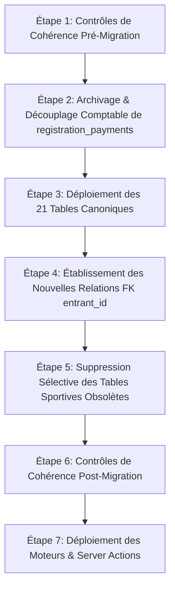
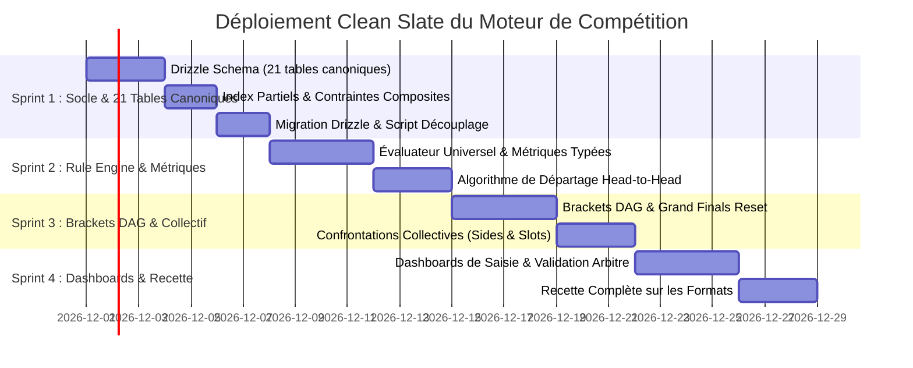

# Document 07 — Feuille de Route d'Implémentation "Clean Slate" et Procédure de Migration Sécurisée (Révisée)

Ce document détaille le plan de déploiement du Scénario C (Clean Slate Universel avec Conservation des Conteneurs — Container Preservation), incluant la procédure pas-à-pas de migration vérifiée, les contrôles pré et post migration et le plan de rollback garantissant l'intégrité absolue du ledger financier.

---

## 1. Procédure de Migration et Découplage Comptable

Pour moderniser le système de compétition sans jamais rompre l'auditabilité des transactions de portefeuilles (`user_wallets`, `wallet_transactions`, `financial_accounts` et `ledger_entries`), la migration applique une stratégie de **Conservation des Conteneurs (Container Preservation)**.

### Pourquoi préserver les conteneurs `tournaments` et `tournament_editions` ?
L'audit de la base de production PostgreSQL 17.12 a identifié des dépendances transversales majeures :
1. **Comptes d'escrow financier (`financial_accounts`) :** 13 comptes réels possèdent un `owner_edition_id` lié à des éditions. Supprimer ces éditions orphelinerait ces comptes et romprait la réconciliation financière.
2. **Historique des communications (`messages`, `interactions`, `notifications`) :** Les discussions et notifications de tournois sont rattachées à `tournament_id` et `edition_id`.

Par conséquent, **les lignes de `tournaments` et `tournament_editions` sont rigoureusement conservées**. Seules les structures sportives obsolètes (`matches`, `bracket_nodes`, `phase_groups`, `tournament_phases`, `edition_registrations`, `tournament_members`, `edition_results`) sont supprimées après découplage et archivage de `registration_payments`.



### Script SQL de Migration Vérifié sous PostgreSQL 17.12

```sql
-- ============================================================================
-- 1. CONTRÔLES PRÉ-MIGRATION (VALIDATION DE COHÉRENCE)
-- ============================================================================
SELECT count(*) AS pending_transactions FROM wallet_transactions WHERE status = 'PENDING';
SELECT count(*) AS total_payments, sum(amount) AS total_amount FROM registration_payments;
SELECT count(*) AS total_wallet_transactions FROM wallet_transactions;
SELECT count(*) AS edition_accounts FROM financial_accounts WHERE owner_edition_id IS NOT NULL;

-- ============================================================================
-- 2. DÉCOUPLAGE ET ARCHIVAGE DE LA TRAÇABILITÉ FINANCIÈRE
-- ============================================================================
-- A. Ajouter les colonnes de snapshot contextuel
ALTER TABLE registration_payments ADD COLUMN IF NOT EXISTS archived_edition_id TEXT;
ALTER TABLE registration_payments ADD COLUMN IF NOT EXISTS archived_edition_name TEXT;
ALTER TABLE registration_payments ADD COLUMN IF NOT EXISTS archived_tournament_id TEXT;
ALTER TABLE registration_payments ADD COLUMN IF NOT EXISTS archived_tournament_name TEXT;
ALTER TABLE registration_payments ADD COLUMN IF NOT EXISTS archived_user_id TEXT;
ALTER TABLE registration_payments ADD COLUMN IF NOT EXISTS archived_team_id TEXT;
ALTER TABLE registration_payments ADD COLUMN IF NOT EXISTS archived_participant_name TEXT;
ALTER TABLE registration_payments ADD COLUMN IF NOT EXISTS archived_registration_type TEXT;

-- B. Peupler le snapshot immuable depuis les tables actuelles
UPDATE registration_payments rp
SET 
  archived_edition_id = te.id,
  archived_edition_name = te.name,
  archived_tournament_id = t.id,
  archived_tournament_name = t.name,
  archived_user_id = tm.user_id,
  archived_team_id = tm.team_id,
  archived_participant_name = tm.display_name,
  archived_registration_type = er.registration_type
FROM edition_registrations er
JOIN tournament_editions te ON te.id = er.edition_id
JOIN tournaments t ON t.id = te.tournament_id
JOIN tournament_members tm ON tm.id = er.member_id
WHERE er.id = rp.registration_id;

-- C. Supprimer la FK cascade vers les anciennes inscriptions et renommer en legacy
ALTER TABLE registration_payments DROP CONSTRAINT IF EXISTS registration_payments_registration_id_fkey;
ALTER TABLE registration_payments ALTER COLUMN registration_id DROP NOT NULL;
ALTER TABLE registration_payments RENAME COLUMN registration_id TO legacy_registration_id;

-- ============================================================================
-- 3. DÉPLOIEMENT DU SCHÉMA DES 21 TABLES CANONIQUES (DRIZZLE MIGRATION)
-- ============================================================================
-- Création des tables : competition_rulesets, ruleset_versions, metric_definitions,
-- ruleset_metric_configs, competition_stages, competition_groups, competition_rounds,
-- competition_entrants, entrant_roster_members, competition_encounters, encounter_sides,
-- encounter_side_entrants, encounter_matches, match_slots, match_games, game_metrics,
-- match_arbitration_logs, tournament_staff.

-- ============================================================================
-- 4. ÉTABLISSEMENT DES NOUVELLES RELATIONS (APRÈS CRÉATION DE competition_entrants)
-- ============================================================================
ALTER TABLE registration_payments ADD COLUMN IF NOT EXISTS entrant_id TEXT 
  REFERENCES competition_entrants(id) ON DELETE SET NULL;

-- ============================================================================
-- 5. SUPPRESSION SÉLECTIVE DES TABLES SPORTIVES OBSOLÈTES
-- (Les conteneurs tournaments et tournament_editions sont INTÉGRALEMENT CONSERVÉS)
-- ============================================================================
DROP TABLE IF EXISTS matches;
DROP TABLE IF EXISTS bracket_nodes;
DROP TABLE IF EXISTS phase_group_participants;
DROP TABLE IF EXISTS phase_groups;
DROP TABLE IF EXISTS tournament_phases;
DROP TABLE IF EXISTS edition_results;
DROP TABLE IF EXISTS edition_registrations;
DROP TABLE IF EXISTS tournament_members;

-- ============================================================================
-- 6. CONTRÔLES POST-MIGRATION (VALIDATION DE PRÉSERVATION FINANCIÈRE ABSOLUE)
-- ============================================================================
SELECT count(*) AS verified_payments, sum(amount) AS verified_total_amount FROM registration_payments;
SELECT count(*) AS total_wallet_transactions FROM wallet_transactions;
SELECT count(*) AS total_wallets FROM user_wallets;
SELECT count(*) AS total_users FROM users;
SELECT count(*) AS total_teams FROM teams;
SELECT count(*) AS preserved_tournaments FROM tournaments;
SELECT count(*) AS preserved_editions FROM tournament_editions;
SELECT count(*) AS preserved_edition_accounts FROM financial_accounts WHERE owner_edition_id IS NOT NULL;
```

---

## 2. Feuille de Route Opérationnelle (4 Sprints de Développement)



### Banc d'Essai Automatisé Reproductible
Pour valider l'intégrité de la migration et l'ensemble des contraintes relationnelles cibles à tout moment :
```bash
bun run test:competition-engine
```

---

## 3. Stratégie de Rollback

En cas d'incident pendant la migration du Sprint 1 :
1. **Restauration Immédiate du Snapshot :** Restauration du snapshot Neon ou dump PostgreSQL réalisé juste avant le script.
2. **Intégrité Comptable Garantie :** Aucune opération ne modifiant les montants ou les soldes dans `wallets` ou `wallet_transactions`, les fonds de tous les utilisateurs restent intangibles.
3. **Conservation des Conteneurs :** Les identifiants `tournaments.id` et `tournament_editions.id` n'ayant pas été altérés, aucune rupture de FK n'est possible sur les flux d'escrow ou les messages.
