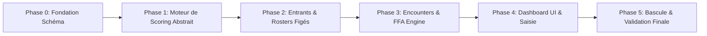

# Document 07 — Feuille de Route d'Implémentation et Stratégie de Transition

Ce document détaille le plan de mise en œuvre opérationnel pour déployer l'architecture cible (Scénario B) de manière sécurisée, incrémentale et sans interruption de service.

---

## 1. Principes de Déploiement : Zéro Régression et Zéro Downtime

1. **Migrations Additives Uniquement :** Aucune colonne ou table existante n'est supprimée ou renommée dans les premières phases.
2. **Double Écriture / Adaptateur :** Les anciennes interfaces continuent de fonctionner grâce à un pont de compatibilité (`legacy-tournament-adapter.ts`).
3. **Validation Financière Indépendante :** Tout mouvement de fonds (inscription payée, distribution de gains) continue de s'appuyer sur le moteur financier déjà éprouvé (`lib/finance`).
4. **Validation par Tests de Bout en Bout :** Chaque nouveau format (Duel, Équipes BO3, Battle Royale FFA) est validé par des suites de tests automatisés simulant l'inscription, la génération, la saisie des scores et la progression jusqu'au podium.

---

## 2. Découpage en 5 Phases Opérationnelles

---

### Phase 0 : Fondations du Schéma et Types Universels (Semaine 1)

#### Objectifs
* Définir les nouvelles tables cibles dans `database/schema.ts` sans modifier les tables existantes.
* Générer et appliquer la migration SQL avec Drizzle Kit.
* Créer les interfaces TypeScript unifiées dans `lib/tournaments/types/universal.ts`.

#### Tâches Techniques
1. Ajouter les tables :
   * `competition_entrants`
   * `entrant_members`
   * `competition_stages`
   * `competition_rounds`
   * `competition_encounters`
   * `encounter_opponents`
   * `encounter_games`
   * `game_participant_scores`
2. Définir les relations Drizzle correspondantes avec intégrité référentielle stricte (`onDelete: 'cascade'`).
3. Écrire le convertisseur bidirectionnel de types (`toLegacyMatch()`, `toUniversalEncounter()`).

---

### Phase 1 : Moteur de Scoring et Stratégies Enfichables (Semaine 2)

#### Objectifs
* Découpler le calcul des scores et des classements de toute sémantique footballistique.
* Implémenter le patron de conception **Strategy** pour les différents types de jeux.

#### Tâches Techniques
1. Créer le répertoire `lib/tournaments/scoring/` :
   * `base-scoring-strategy.ts` (Interface commune).
   * `sports-scoring-strategy.ts` (Football : Victoire 3 pts, Nul 1 pt, Goal Average).
   * `versus-series-scoring-strategy.ts` (FPS / Fighting : Best-of-3 / Best-of-5, victoires de cartes).
   * `battle-royale-scoring-strategy.ts` (Barème de placement Top 1-20 + multiplicateur de frags).
   * `racing-scoring-strategy.ts` (Points par rang + chronométrage).
2. Adapter `lib/tournaments/standings.engine.ts` pour déléguer le tri et le calcul à la stratégie choisie par l'édition.
3. Écrire des tests unitaires complets sur chaque barème avec cas d'égalités multiples.

---

### Phase 2 : Gestion Avancée des Entrants et des Rosters (Semaine 3)

#### Objectifs
* Permettre l'inscription d'équipes avec composition figée par édition.
* Gérer les joueurs invités sans compte utilisateur de façon propre.

#### Tâches Techniques
1. Mettre à jour `actions/editions.ts` (`joinEdition`) :
   * Lors de l'inscription d'une équipe, copier la liste des joueurs actuels dans `entrant_members` pour figer la composition.
   * Permettre au capitaine d'ajouter des remplaçants (`SUBSTITUTE`) ou un coach.
2. Développer l'action d'ajout manuel de participants invités (`addGuestEntrantAction`) :
   * Crée directement un `competition_entrant` avec `is_guest = true`, sans polluer la table globale `tournament_members`.
3. Mettre à jour le composant de gestion des participants (`participants-management-client.tsx`) pour afficher le roster d'équipe et les statuts de check-in.

---

### Phase 3 : Moteur d'Encounters et Support FFA / Battle Royale (Semaine 4)

#### Objectifs
* Permettre la génération et la gestion de confrontations à N adversaires ($N \ge 2$).
* Prendre en charge le découpage en sous-manches (`encounter_games`).

#### Tâches Techniques
1. Créer `lib/tournaments/encounter-engine.ts` :
   * Création d'une confrontation avec collection d'opposants (`encounter_opponents`).
   * Initialisation des manches prévues (`encounter_games`).
2. Mettre à jour `match-generation-engine.ts` pour générer :
   * Soit des duels classiques (Arbre ou Poules).
   * Soit des salons/lobbies Battle Royale (ex. 16 escouades regroupées dans la même confrontation multi-manches).
3. Mettre à jour `progression-engine.ts` pour propager les qualifiés en fonction des `calculated_points` de chaque opposant.

---

### Phase 4 : Interfaces Utilisateurs et Saisie des Résultats (Semaine 5)

#### Objectifs
* Offrir une ergonomie moderne pour la saisie et la validation des scores sur mobile et desktop.

#### Tâches Techniques
1. **Interface de Match Duel (BO3 / BO5) :**
   * Affichage manche par manche (Carte 1, Carte 2, Carte 3).
   * Saisie des scores par carte avec upload de screenshot de preuve.
2. **Interface de Match Battle Royale (Lobby FFA) :**
   * Tableau de saisie rapide : pour chaque escouade, saisie du rang (Top X) et du nombre de kills.
   * Calcul en direct du total de points et du classement provisoire de la manche.
3. **Tableau de Bord Organisateur :**
   * Validation en un clic des résultats certifiés par l'arbitre.
   * Déclenchement automatique de la progression vers le tour ou la phase suivante.

---

### Phase 5 : Tests de Recette, Déploiement et Migration (Semaine 6)

#### Objectifs
* Déployer en production, tester les nouveaux formats réels et finaliser la documentation.

#### Tâches Techniques
1. Exécution de scénarios de tests complets sur environnement de staging :
   * Tournoi eFootball 1v1 (Poules + Élimination directe).
   * Tournoi Call of Duty Mobile 5v5 (Arbre BO3).
   * Tournoi Free Fire Battle Royale (12 équipes, 4 manches).
2. Déploiement progressif (Feature Flag : `ENABLE_UNIVERSAL_COMPETITION_ENGINE = true`).
3. Formation et documentation pour les organisateurs de tournois.

---

## 3. Matrice de Gestion des Risques

| Risque Identifié | Probabilité | Impact | Stratégie d'Atténuation |
|:---|:---:|:---:|:---|
| **Régression sur les tournois eFootball en cours** | Faible | Élevé | Couche d'adaptation maintenant l'API historique ; les éditions existantes ne sont pas migrées de force. |
| **Erreur de calcul sur le prize pool** | Très Faible | Critique | La table `financialAccounts` et les transactions du wallet restent la seule autorité pour les paiements. |
| **Complexité de saisie mobile pour les tournois BR** | Moyenne | Moyen | Conception d'un formulaire de saisie ultra-simplifié pré-remplissant les escouades et vérifiant la somme des rangs. |
| **Augmentation du temps de build ou de requête** | Faible | Faible | Indexation rigoureuse sur `(edition_id, stage_id, status)` et jointures optimisées Drizzle. |
