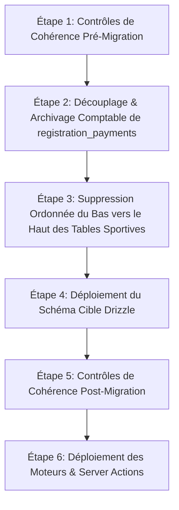
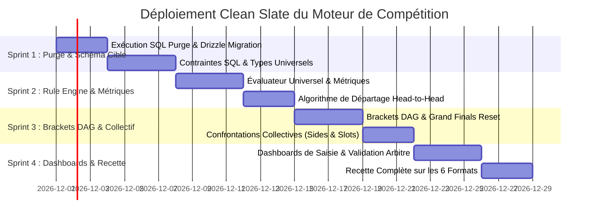

# Document 07 — Feuille de Route d'Implémentation "Clean Slate" et Procédure de Migration Sécurisée (Révisée)

Ce document détaille le plan de déploiement du Scénario C (Clean Slate Universel), incluant la procédure pas-à-pas de migration vérifiée, les contrôles pré et post migration et le plan de rollback garantissant l'intégrité absolue du ledger financier.

---

## 1. Procédure de Migration et Découplage Comptable

Pour supprimer les anciennes compétitions sans jamais rompre l'auditabilité des transactions de portefeuilles (`wallets` et `walletTransactions`), la migration exclut tout recours à un `TRUNCATE CASCADE` aveugle et applique un ordre strict de déconnexion et de suppression.



### Script SQL de Migration Vérifié

```sql
-- 1. Contrôles pré-migration
SELECT count(*) AS pending_tx_count FROM wallet_transactions WHERE status = 'PENDING';
SELECT count(*) AS total_payments, sum(amount) AS total_amount FROM registration_payments;

-- 2. Découplage comptable sans perte de données
ALTER TABLE registration_payments ADD COLUMN IF NOT EXISTS archived_edition_name TEXT;
ALTER TABLE registration_payments ADD COLUMN IF NOT EXISTS archived_user_id TEXT;

UPDATE registration_payments rp
SET 
  archived_edition_name = te.name,
  archived_user_id = tm.user_id
FROM edition_registrations er
JOIN tournament_editions te ON te.id = er.edition_id
JOIN tournament_members tm ON tm.id = er.member_id
WHERE er.id = rp.registration_id;

-- Supprimer la FK cascade vers les anciennes inscriptions
ALTER TABLE registration_payments DROP CONSTRAINT IF EXISTS registration_payments_registration_id_fkey;
ALTER TABLE registration_payments ALTER COLUMN registration_id DROP NOT NULL;
ALTER TABLE registration_payments RENAME COLUMN registration_id TO legacy_registration_id;

-- 3. Suppression ordonnée des tables sportives
DROP TABLE IF EXISTS matches;
DROP TABLE IF EXISTS bracket_nodes;
DROP TABLE IF EXISTS phase_group_participants;
DROP TABLE IF EXISTS phase_groups;
DROP TABLE IF EXISTS tournament_phases;
DROP TABLE IF EXISTS edition_results;
DROP TABLE IF EXISTS edition_registrations;
DROP TABLE IF EXISTS tournament_members;
DELETE FROM tournament_editions;
DELETE FROM tournaments;

-- 4. Contrôles post-migration
SELECT count(*) AS total_payments, sum(amount) AS total_amount FROM registration_payments;
SELECT count(*) AS total_wallet_transactions FROM wallet_transactions;
SELECT count(*) AS total_user_wallets FROM user_wallets;
```

---

## 2. Feuille de Route Opérationnelle (4 Sprints de Développement)



---

## 3. Stratégie de Rollback

En cas d'incident pendant la migration du Sprint 1 :
1. **Sauvegarde immuable :** Restauration immédiate du snapshot Neon / dump SQL créé avant le démarrage.
2. **Aucune perte de fonds :** Les tables financières (`wallets`, `wallet_transactions`, `financial_accounts`) n'étant pas modifiées dans leur structure, l'intégrité comptable reste préservée à tout instant.
