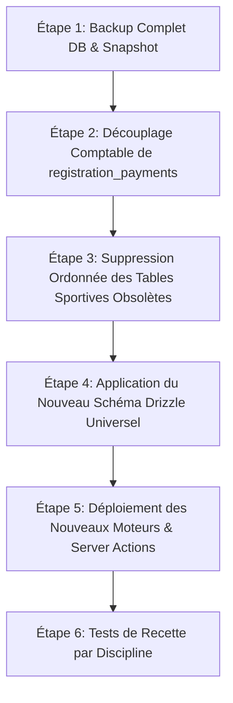
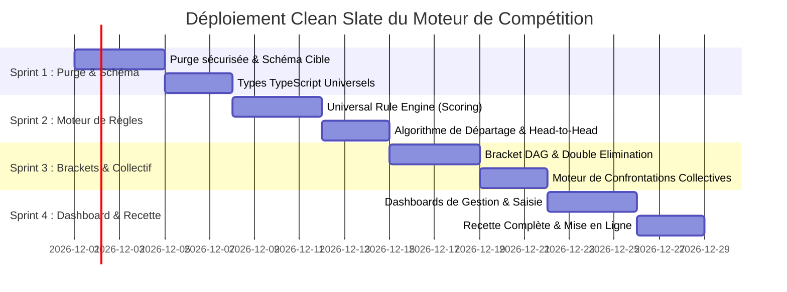

# Document 07 — Feuille de Route d'Implémentation "Clean Slate" et Procédure de Purge Sécurisée

Ce document détaille le plan de déploiement du Scénario C (Clean Slate Universel), incluant la procédure pas-à-pas de purge sécurisée garantissant l'intégrité absolue des données financières et des identités.

---

## 1. Procédure de Purge Sécurisée et Préservation Financière

Pour supprimer les anciennes compétitions sans jamais rompre l'auditabilité des transactions de portefeuilles (`wallets` et `walletTransactions`), la migration doit suivre une séquence chirurgicale stricte :

### Détail des Étapes de la Purge
1. **Étape 1 — Sauvegarde Complète :** Réalisation d'un dump SQL complet sous Neon / PostgreSQL avant toute manipulation.
2. **Étape 2 — Préservation du Lien Financier :**
   * Dans `registration_payments`, supprimer la contrainte `FOREIGN KEY ... ON DELETE CASCADE` vers `edition_registrations`.
   * Transformer `registration_id` en champ historique non contraignant (`text`), ou archiver les lignes de `registration_payments` dans une table historique `archived_registration_payments` qui conserve le `transactionId`, le montant, la devise et le libellé de l'ancienne édition.
   * Ainsi, aucune ligne de `wallet_transactions` ne se retrouve orpheline sans explication comptable.
3. **Étape 3 — Purge des Tables Compétitives Obsolètes :**
   * Suppression dans l'ordre strict des dépendances :
     1. `matches`
     2. `bracket_nodes`
     3. `phase_group_participants`
     4. `phase_groups`
     5. `tournament_phases`
     6. `edition_results`
     7. `edition_registrations`
     8. `tournament_members`
     9. `tournament_editions`
     10. `tournaments`
4. **Étape 4 — Déploiement du Schéma Cible :**
   * Création des nouvelles tables propres avec relations Drizzle complètes.

---

## 2. Feuille de Route Opérationnelle (4 Sprints de Développement)

Grâce à la suppression du besoin d'adaptateurs de compatibilité, le délai de réalisation passe de 6 à **4 semaines de développement focalisé**.

---

### Sprint 1 : Purge Sécurisée, Déploiement du Schéma et Types (Semaine 1)

#### Livrables
* Script SQL de purge sécurisée préservant le ledger et archivant les paiements d'inscriptions.
* Nouveau schéma Drizzle dans `database/schema.ts` :
  * `tournament_staff`
  * `competition_entrants`
  * `entrant_roster_members`
  * `competition_stages`
  * `competition_groups`
  * `competition_rounds`
  * `competition_encounters`
  * `encounter_sides`
  * `encounter_side_entrants`
  * `encounter_matches`
  * `match_slots`
  * `match_games`
  * `competition_rulesets`
* Migration appliquée et validée.

---

### Sprint 2 : Moteur de Règles Universel et Calcul de Classement (Semaine 2)

#### Livrables
* `lib/tournaments/rules/rule-engine.ts` : Évaluateur universel de règles sans classes par jeu.
* Prise en charge des trois modes :
  * Mode Points (Victoire/Nul/Défaite).
  * Mode Accumulation Métrique (Battle Royale : Placement + Kills).
  * Mode Séries (Best-of-X).
* Implémentation complète et rigoureuse de la chaîne de départage :
  * `POINTS`
  * `HEAD_TO_HEAD` (vraie confrontation directe entre les participants à égalité)
  * `GOAL_DIFF`
  * `WINS_COUNT`
  * `GOALS_FOR`
  * `LAST_GAME_PLACEMENT`
* Suite de tests unitaires (100% couverture sur le rule engine).

---

### Sprint 3 : Brackets DAG, Double Élimination et Confrontations Collectives (Semaine 3)

#### Livrables
* `lib/tournaments/brackets/dag-engine.ts` :
  * Résolution des dépendances de progression relationnelles (`match_slots`).
  * Upper Bracket, Lower Bracket, Grand Finals et Bracket Reset automatique.
  * Validation d'acyclicité (aucun cycle possible dans l'arbre).
  * Traitement formel des BYE et des dérogations manuelles par l'arbitre (`is_locked`).
* `lib/tournaments/fixtures/collective-engine.ts` :
  * Gestion des confrontations Région A contre Région B.
  * Répartition des joueurs dans les camps (`encounter_sides`).
  * Agrégation automatique des résultats des sous-matchs (points de match ou scores cumulés).

---

### Sprint 4 : Refonte des Dashboards et Recette Globale (Semaine 4)

#### Livrables
* Écrans de gestion rénovés :
  * Page d'inscription avec composition de roster figée et choix du club en jeu.
  * Tableau de saisie de match pour Duels BO3/BO5 (carte par carte avec preuves).
  * Tableau de saisie rapide pour Lobbies Battle Royale (saisie Top et Kills en grille fluide).
  * Vue de confrontation collective affichant le score global et les sous-matchs.
* Recette fonctionnelle sur 4 tournois tests complets :
  1. eFootball 1v1 (Championnat + Playoffs).
  2. Call of Duty Mobile 5v5 (Arbre Double Élimination BO3).
  3. Free Fire Battle Royale (12 escouades, 4 manches).
  4. Choc Inter-Régions Dakar vs Thiès (Confrontation collective 5 sous-matchs).
* Déploiement en production.
